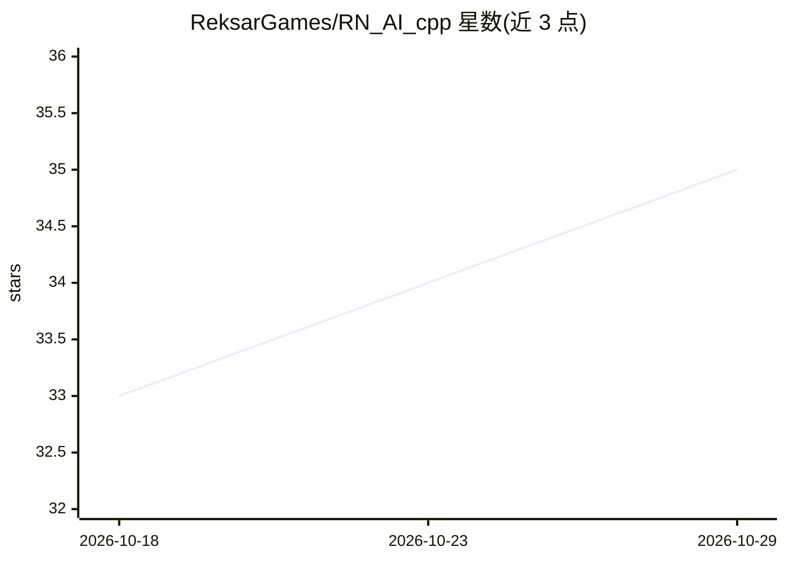

# ReksarGames/RN_AI_cpp

⭐ 35 · C++ · MIT · 推送 2026-02-24 · [GitHub](https://github.com/ReksarGames/RN_AI_cpp) · [官网](https://mega.nz/file/T8IFHS7I#70_WjY_-3rDZ82U3yKS3meS8mk3bV29_RFrSCQRlFhg) · 个人维护 · 中文 README

**基于 AI 目标检测的 FPS/TPS 游戏自瞄工具**

Windows 平台的 C++ 游戏瞄准辅助程序：通过 DirectX Duplication/WCRT/OBS 方式截屏，使用神经网络（DirectML 或 CUDA+TensorRT 后端）或颜色过滤检测目标，经卡尔曼滤波预测移动后，经由 WIN32 API 或 Makcu/Kmbox 外部输入设备执行鼠标操作；提供 ImGui 菜单、桌面覆盖层显示 FPS/延迟/检测框。发行版提供 DirectML（任意 GPU）与 CUDA+TensorRT（RTX 2000 及更新、GTX 1660）两种构建，CUDA 构建不支 Pascal 及更旧显卡。

## 筛选速览

| 维度 | 判定 | 备注 |
|---|---|---|
| AI 角色 | `ai-native` | 本体是模型或模型工具 |
| 许可风险 | `permissive` | MIT |
| 部署形态 | `None` |  |
| 模型依赖 | — | README 未给出锁定关系 |
| 硬件要求 | — | 无带数字的原话,不猜 |
| 安装摩擦 | `medium` | 含编译或系统依赖之一 |
| 成熟度 | — | 结构信号不足 |

## 能力要点

- 三种检测后端：DirectML、CUDA+TensorRT、颜色检测
- 卡尔曼滤波平滑瞄准与目标移动预测可视化
- 支持 Makcu/Kmbox/KmboxNet 外部输入设备
- ImGui 菜单与游戏覆盖层（FPS/延迟/检测框）实时显示

## 适用场景

- 在 FPS/TPS 游戏中自动检测并瞄准目标
- 使用旧 GPU 或 AMD/Intel 显卡时选择 DirectML 构建
- 通过颜色过滤在特定色彩场景下选择目标

## 场景标签

`目标检测` · 领域:感知与多模态

## 证据(README 行号)

> L17: |**🎯 AI Detection**|Target detection using neural networks with high accuracy|
> L152: 🧠 **detector/** — Target detection system
> L154: - TensorRT detector (NVIDIA) — `trt_detector`

## 星数曲线

2026-10-18 33 → 2026-10-29 35（+2）

---
*卡片 v1 · prompt 1.4 · 生成 2026-10-25 · 置信度 high · 依据 README sha `1fd3138511b1` · [字段定义](../../DATASET.md)*
