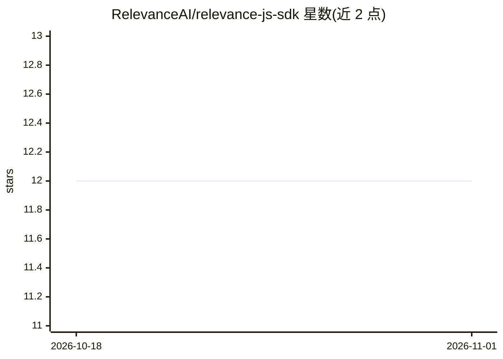

# RelevanceAI/relevance-js-sdk

⭐ 12 · TypeScript · MIT · 推送 2026-03-12 · [GitHub](https://github.com/RelevanceAI/relevance-js-sdk) · [官网](https://relevanceai.com/) · 组织维护

**Relevance AI 平台的官方 JavaScript/TypeScript SDK**

由 Relevance AI 官方维护的 JS/TS SDK，用于接入其 agents 与 workforces 平台：加载 agent、发起对话、管理任务生命周期与事件订阅、消息与附件处理、多 agent 编排及实时流式 token。支持 Node.js、Deno、Bun、Cloudflare Workers 与浏览器多种运行时，基于 Web 标准实现、零依赖，提供完整 TypeScript 类型。用 Deno 开发并发布至 npm 与 JSR。

## 筛选速览

| 维度 | 判定 | 备注 |
|---|---|---|
| AI 角色 | `ai-ecosystem` | LLM/agent 周边工具 |
| 许可风险 | `permissive` | MIT |
| 部署形态 | `library` | 以包/库形式分发 |
| 模型依赖 | — | README 未给出锁定关系 |
| 硬件要求 | — | 无带数字的原话,不猜 |
| 安装摩擦 | `low` | 无编译、无系统依赖或容器化 |
| 成熟度 | — | 结构信号不足 |

## 能力要点

- 覆盖 Node.js/Deno/Bun/Cloudflare Workers/浏览器的通用运行时支持
- 基于 EventTarget API 的事件驱动架构，支持实时更新与流式 token
- 零依赖，提供完整 TypeScript 类型定义
- 提供 Deno 与浏览器（Preact 聊天应用）示例

## 适用场景

- 在前端或 Node 应用中接入 Relevance AI 的 agent 对话
- 订阅 agent 任务事件并处理流式输出
- 构建基于 Relevance AI 多 agent 编排（workforces）的应用

## 场景标签

`Agent 框架` `多智能体` · 领域:Agent 开发

## 证据(README 行号)

> L3: The official JavaScript/TypeScript SDK for building applications
> L4: with Relevance AI agents and workforces.

## 星数曲线

2026-10-18 12 → 2026-11-01 12（+0）

---
*卡片 v1 · prompt 1.4 · 生成 2026-11-01 · 置信度 high · 依据 README sha `37ecd44f962e` · [字段定义](../../DATASET.md)*
