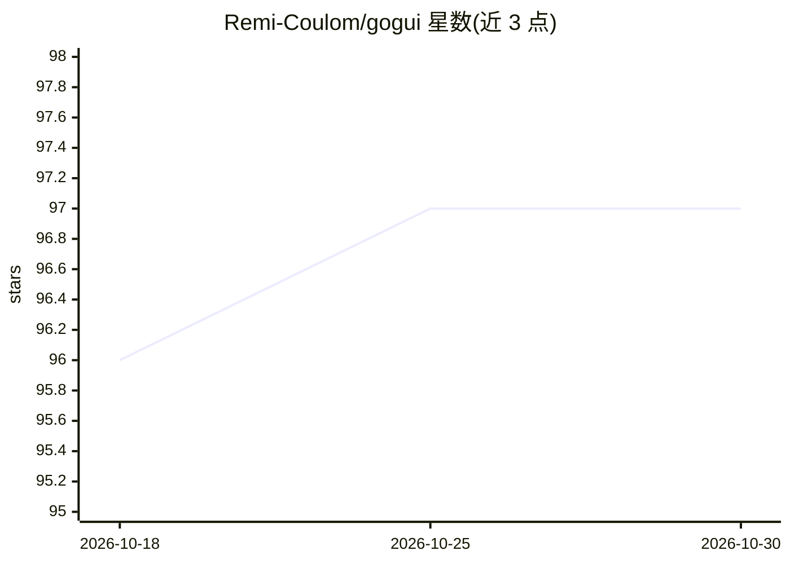

# Remi-Coulom/gogui

⭐ 97 · Java · NOASSERTION · 推送 2025-12-03 · [GitHub](https://github.com/Remi-Coulom/gogui) · 个人维护

**围棋等棋类 AI 引擎的图形界面，基于 GTP 协议**

基于 GTP 协议的棋盘游戏 AI 软件图形界面：可视化棋盘、保存 sgf 棋谱、支持人机对弈，供 AI 开发者调试引擎。引擎可定义 analyze 命令扩展自定义命令，在棋盘上图形化展示信息或打开参数设置对话框；附带 gogui-twogtp 等工具在两个程序间运行对局并收集统计。协议虽为围棋设计但已扩展至任意棋类（含六角棋 Hex、Yavalath、国际象棋引擎）。以 zip 分发包提供源码与编译好的 jar，运行需安装 Java 运行环境。

## 筛选速览

| 维度 | 判定 | 备注 |
|---|---|---|
| AI 角色 | `ai-ecosystem` | LLM/agent 周边工具 |
| 许可风险 | `none` | NOASSERTION |
| 部署形态 | `None` |  |
| 模型依赖 | — | README 未给出锁定关系 |
| 硬件要求 | — | 无带数字的原话,不猜 |
| 安装摩擦 | `low` | 无编译、无系统依赖或容器化 |
| 成熟度 | — | 结构信号不足 |

## 能力要点

- 可视化棋盘、sgf 棋谱保存、人机对弈
- GTP analyze 命令扩展自定义命令并图形化展示引擎信息
- gogui-twogtp 等工具运行程序间对局并收集统计
- 支持围棋之外的棋类（Hex、Yavalath、国际象棋引擎）

## 适用场景

- 调试和可视化我的 GTP 围棋引擎
- 让两个棋类 AI 程序自动对局并收集统计数据
- 与自己的棋类 AI 引擎对弈并保存棋谱

## 场景标签

 · 领域:游戏/计算机博弈工具

## 证据(README 行号)

> L3: GoGui is a graphical interface to board-game AI software, using the [GTP
> L10: features for AI developers:

## 星数曲线

2026-10-18 96 → 2026-10-30 97（+1）

---
*卡片 v1 · prompt 1.4 · 生成 2026-10-23 · 置信度 high · 依据 README sha `c6b7f0a980af` · [字段定义](../../DATASET.md)*
