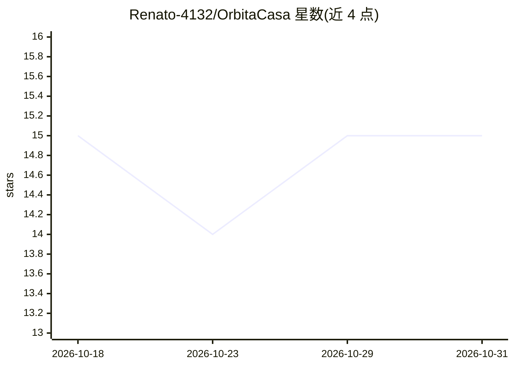

# Renato-4132/OrbitaCasa

⭐ 15 · Python · NOASSERTION · 推送 2026-10-30 · [GitHub](https://github.com/Renato-4132/OrbitaCasa) · [官网](https://renato-4132.github.io/OrbitaCasa/) · 个人维护

**本地优先的家庭财务全功能管理软件（含 AI 分析）**

面向家庭与个人用户的桌面财务管理软件（Windows/macOS/Linux），数据仅存本地、无云端、刻意避开 PSD2 银行 API。提供 70+ 功能：PDF/CSV 银行流水导入、Gmail 发票同步、自动分类（SmartCat）、预算监控、金融市场监管、房贷贷款模拟、多人费用分摊（FairShare）、饮食与宠物模块等。AI 功能包括财务分析、自然语言查询数据库、多文档语义分析与扫描件 AI 分析（依赖 google-genai 等库自动安装）。Windows 有安装包，macOS 安装脚本为实验性，另提供 Docker 浏览器访问方案。采用使用积分延长免费期的许可模式。

## 筛选速览

| 维度 | 判定 | 备注 |
|---|---|---|
| AI 角色 | `ai-enhanced` | 去掉 AI 部分产品仍成立 |
| 许可风险 | `none` | NOASSERTION |
| 部署形态 | `self-host` | docker 或自建部署 |
| 模型依赖 | — | README 未给出锁定关系 |
| 硬件要求 | — | 无带数字的原话,不猜 |
| 安装摩擦 | `low` | 无编译、无系统依赖或容器化 |
| 成熟度 | `idea` | |

## 能力要点

- 数据仅存本地（Zero Cloud），不接入银行 PSD2 API
- PDF/CSV 流水导入与 Gmail 发票自动归档，SmartCat 历史自动分类
- AI 财务分析、自然语言查询数据库、多文档语义分析
- Docker 部署后可通过浏览器/手机远程访问

## 适用场景

- 家庭记账、预算监控与储蓄目标管理
- 集中归档发票、工资单等 PDF 财务文档
- 多人家庭/团体费用分摊与共用账目管理
- 在 NAS 或服务器上部署后远程查看家庭财务

## 场景标签

 · 领域:个人/家庭财务

## 证据(README 行号)

> L81: 29. **Analisi Finanziaria con IA** — Analisi intelligente dell'andamento complessivo
> L82: 30. **Chiedi al Database con l'IA** — Domande in linguaggio naturale su tutti i moduli, anche da browser e con alle
> L104: 49. **Analizzatore Semantico IA** — Analisi intelligente e confronto multi-documento

## 星数曲线

2026-10-18 15 → 2026-10-31 15（+0）

---
*卡片 v1 · prompt 1.4 · 生成 2026-10-30 · 置信度 high · 依据 README sha `582924c1de12` · [字段定义](../../DATASET.md)*
