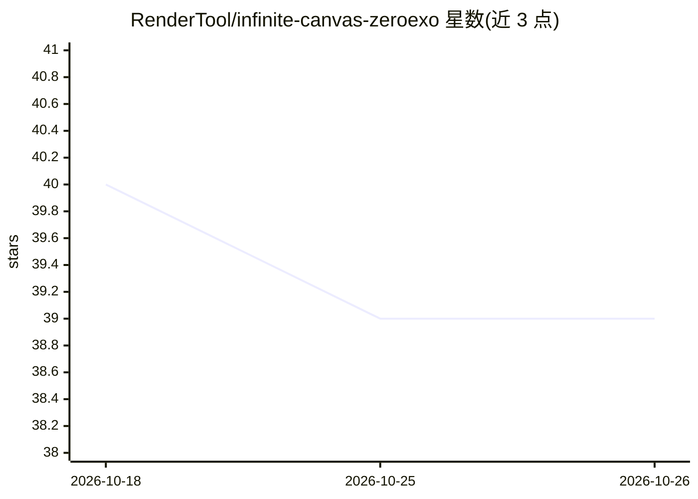

# RenderTool/infinite-canvas-zeroexo

⭐ 39 · TypeScript · MIT · 推送 2026-09-06 · [GitHub](https://github.com/RenderTool/infinite-canvas-zeroexo) · 个人维护 · 中文 README

**面向创作者的 AI 短片创作画布平台：剧本到成片全流程**

基于 React 画布前端 + NestJS 管理端 + PostgreSQL 后端的全栈平台，覆盖剧本→分镜→镜头→成片的 AI 制片流程。画布支持自研 React DOM 引擎、节点编排与 AI 逐节点对话；画布 Agent 编排分镜/制片等子 Agent，推理与工具调用呈现为可折叠轨迹树。实时协作采用 Yjs CRDT + Hocuspocus，支持多用户光标、离线优先本地持久化与权限分级。管理端提供 API 供应商管理、用户 RBAC、计费与分析面板。README 声明处于早期开发阶段，API 与 UI 频繁变动。提供 Docker Compose 部署与本地开发（Node.js≥18、pnpm≥9、PostgreSQL 16、Redis 7、MinIO）两种方式。

## 筛选速览

| 维度 | 判定 | 备注 |
|---|---|---|
| AI 角色 | `ai-native` | 本体是模型或模型工具 |
| 许可风险 | `permissive` | MIT |
| 部署形态 | `self-host` | docker 或自建部署 |
| 模型依赖 | — | README 未给出锁定关系 |
| 硬件要求 | — | 无带数字的原话,不猜 |
| 安装摩擦 | `low` | 无编译、无系统依赖或容器化 |
| 成熟度 | `idea` | |

## 能力要点

- 剧本→分镜→镜头→成片的 AI 制片流程，每个节点可对话
- 画布 Agent 编排脚本/分镜/制片子 Agent，含节点级 AI 记忆
- Yjs CRDT + Hocuspocus 实时协作与离线优先本地持久化
- 管理端提供 API 供应商管理、RBAC、计费与分析（ECharts）

## 适用场景

- 在无限画布上从想法推进到分镜和成片
- 多人在同一画布实时协作编辑
- 平台运营者通过管理端管理用户、API 密钥与计费

## 场景标签

`视频生成` `多智能体` · 领域:Agent 开发

## 证据(README 行号)

> L9:  A full-stack, AI-driven canvas platform. From idea to storyboard, from shots to a finished short film — one platfor
> L18: - **AI film-out pipeline** — Script → storyboard → shots → finished film; every node can chat with AI
> L20: - **Intelligent agents** — One canvas agent orchestrates script / storyboard / production sub-agents; reasoning and

## 星数曲线

2026-10-18 40 → 2026-10-26 39（-1）

---
*卡片 v1 · prompt 1.4 · 生成 2026-10-25 · 置信度 mid · 依据 README sha `dfb49bf07a46` · [字段定义](../../DATASET.md)*
