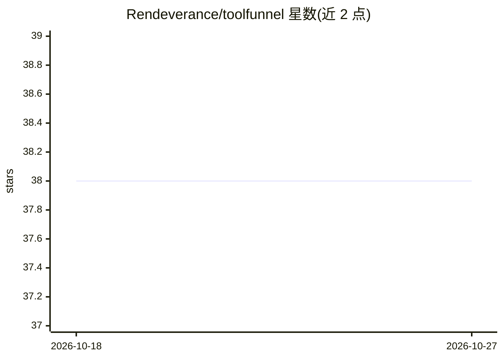

# Rendeverance/toolfunnel

⭐ 38 · JavaScript · MIT · 推送 2026-09-21 · [GitHub](https://github.com/Rendeverance/toolfunnel) · 个人维护

**零依赖 MCP 网关：聚合自有与上游 MCP 工具并按策略放行**

面向使用 MCP 工具的 AI agent 开发者的本地网关：以单个 MCP 服务器形式位于 agent 与各工具之间，支持用 JSON 注册表托管任意语言编写的脚本工具、转发并筛选其他 MCP 服务器的工具、通过简短 brief 按需加载工具说明以压缩上下文 token；每次调用经过服务端 PreToolUse/PostToolUse 策略门（fail-closed），策略随网关迁移、不依赖宿主客户端。还提供零代码构建 MCP 服务器并打包为 npm 包、以及一条命令将 MCP 服务器在新旧两代协议间透明转换的 wrap 功能。零依赖设计便于审计。

## 筛选速览

| 维度 | 判定 | 备注 |
|---|---|---|
| AI 角色 | `ai-ecosystem` | LLM/agent 周边工具 |
| 许可风险 | `permissive` | MIT |
| 部署形态 | `library` | 以包/库形式分发 |
| 模型依赖 | — | README 未给出锁定关系 |
| 硬件要求 | — | 无带数字的原话,不猜 |
| 安装摩擦 | `low` | 无编译、无系统依赖或容器化 |
| 成熟度 | — | 结构信号不足 |

## 能力要点

- lean register：agent 只见简短工具 brief，完整说明按需获取以节省 token
- 服务端策略门（PreToolUse/PostToolUse hooks），fail-closed，策略跨客户端生效
- 零代码构建 MCP 服务器并经 tf_pack 打包为 npx 可安装的 npm 包
- toolfunnel wrap 一条命令在新旧两代 MCP 协议间透明桥接任意 MCP 服务器

## 适用场景

- 把分散的本地脚本和多个 MCP 服务器聚合到一处供 agent 调用
- 在网关侧统一实施工具调用策略，不依赖特定客户端的 hooks 支持
- 让旧协议 MCP 服务器在协议升级后继续可被新客户端使用
- 把自己的脚本工具打包成一个可发布的 MCP 服务器

## 场景标签

`Agent 框架` · 领域:Agent 开发

## 证据(README 行号)

> L7: > A zero-dependency MCP and Local tool gateway: host your own tools in any language, forward and curate tools from o
> L33: ToolFunnel is one small MCP server that sits between your agent and everything else:

## 星数曲线

2026-10-18 38 → 2026-10-27 38（+0）

---
*卡片 v1 · prompt 1.4 · 生成 2026-10-25 · 置信度 high · 依据 README sha `8d4443940469` · [字段定义](../../DATASET.md)*
