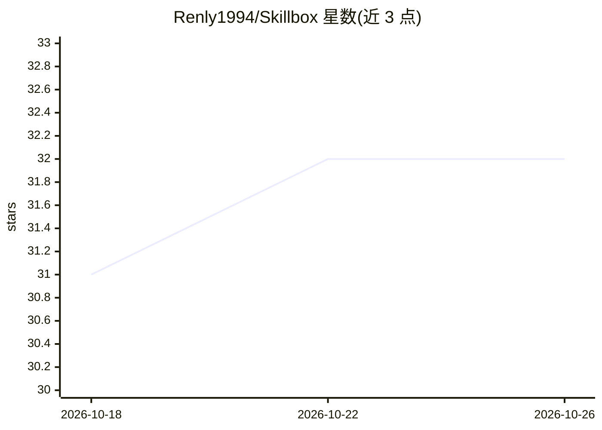

# Renly1994/Skillbox

⭐ 32 · TypeScript · MIT · 推送 2026-10-24 · [GitHub](https://github.com/Renly1994/Skillbox) · 个人维护 · 中文 README

**统一管理 46 种 AI 编码工具的 Skill 与 MCP 的桌面应用**

基于 Electron 的本地优先桌面应用：将本地 Skill 作为母本集中维护，按 Agent 独立启用并适配到 Claude Code、Cursor、Codex 等 46 个目标；MCP 配置可集中查看、比较、跨 Agent 同步，修改前自动备份。提供来源关联更新、历史版本快照、迁移包导出导入，以及 90,000+ Skill 市场。中文翻译功能支持用户自备 DeepSeek、OpenAI、Claude 或兼容 API。本地管理、历史版本和已有译文离线可用，无需注册账号。

## 筛选速览

| 维度 | 判定 | 备注 |
|---|---|---|
| AI 角色 | `ai-ecosystem` | LLM/agent 周边工具 |
| 许可风险 | `permissive` | MIT |
| 部署形态 | `library` | 以包/库形式分发 |
| 模型依赖 | — | README 未给出锁定关系 |
| 硬件要求 | — | 无带数字的原话,不猜 |
| 安装摩擦 | `low` | 无编译、无系统依赖或容器化 |
| 成熟度 | — | 结构信号不足 |

## 能力要点

- 46 个 Agent 适配目标，Skill 母本统一维护、按工具启用
- MCP 配置集中查看、差异检测、跨 Agent 适配与同步
- 90,000+ Skill 市场与 GitHub 来源更新、历史版本快照
- 本地优先，离线可用，无需注册账号

## 适用场景

- 多个 AI 编码工具间复用和同步同一套 Skill
- 集中管理各 Agent 的 MCP 配置并检测差异
- 换设备时用迁移包导出导入 Skill 与启用关系

## 场景标签

 · 领域:AI 开发者工具/Agent 资产管理

## 证据(README 行号)

> L7:  Skillbox 统一管理 Claude Code、Codex、Cursor 等工具的 Skill 与 MCP。
> L29: - **MCP 统一管理**：集中查看配置，支持添加、移除、跨 Agent 适配和配置同步；自动检测差异，修改前备份，外部变化后自动刷新
> L130: 此外，Skillbox 支持将 `~/.agents/skills` 作为跨 Agent 共用的 **通用 Skill 目录**。

## 星数曲线

2026-10-18 31 → 2026-10-26 32（+1）

---
*卡片 v1 · prompt 1.4 · 生成 2026-10-26 · 置信度 high · 依据 README sha `279c949b2679` · [字段定义](../../DATASET.md)*
