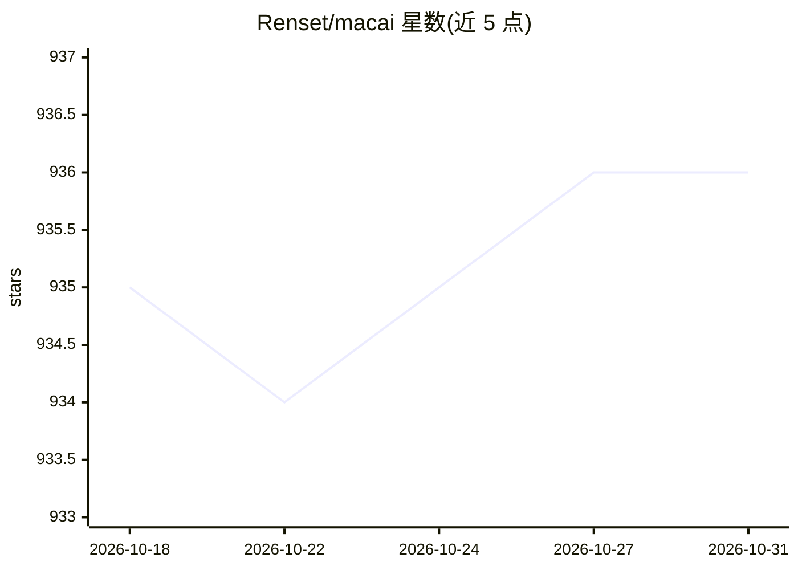

# Renset/macai

⭐ 936 · Swift · Apache-2.0 · 推送 2026-08-16 · [GitHub](https://github.com/Renset/macai) · [官网](https://macai.chat) · 个人维护

**原生 macOS AI 聊天客户端：一个应用接入多家 AI 服务**

面向 Mac 用户的原生 AI 聊天客户端，通过 API token 接入 ChatGPT、Claude、xAI (Grok)、Google Gemini、Perplexity、OpenRouter、Ollama 及任意 OpenAI 兼容 API。功能包括视觉、图像生成、搜索、推理、导入导出，以及跨设备 iCloud 同步（自建构建需自备 CloudKit 容器，无开发者账号可编译但 iCloud 同步不可用）。提供经 Apple 公证的通用二进制下载与 Homebrew cask 安装，要求 macOS 14.0+，Intel 与 Apple 芯片均支持。

## 筛选速览

| 维度 | 判定 | 备注 |
|---|---|---|
| AI 角色 | `ai-native` | 本体是模型或模型工具 |
| 许可风险 | `permissive` | Apache-2.0 |
| 部署形态 | `None` |  |
| 模型依赖 | local-ok | 支持本地模型 |
| 硬件要求 | — | 无带数字的原话,不猜 |
| 安装摩擦 | `medium` | 含编译或系统依赖之一 |
| 成熟度 | — | 结构信号不足 |

## 能力要点

- 支持多家 AI 提供商及任意 OpenAI 兼容 API
- 视觉、图像生成、搜索、推理、导入导出等功能
- iCloud 同步聊天、消息与设置（无遥测）
- 提供 Apple 公证的通用二进制与 Homebrew 安装

## 适用场景

- 在 Mac 上用一个应用管理多家 AI 服务的对话
- 搭配本地 Ollama 免费运行开源模型
- 通过 iCloud 在多台设备间同步聊天记录

## 场景标签

`聊天机器人` · 领域:对话与助手

## 证据(README 行号)

> L8: macai (macOS AI) is a simple yet powerful native macOS AI chat client that supports most AI providers: ChatGPT, Clau
> L34: ## Run with ChatGPT, Claude, xAI or Google Gemini

## 星数曲线

2026-10-18 935 → 2026-10-31 936（+1）

---
*卡片 v1 · prompt 1.4 · 生成 2026-10-21 · 置信度 high · 依据 README sha `3397d9882933` · [字段定义](../../DATASET.md)*
