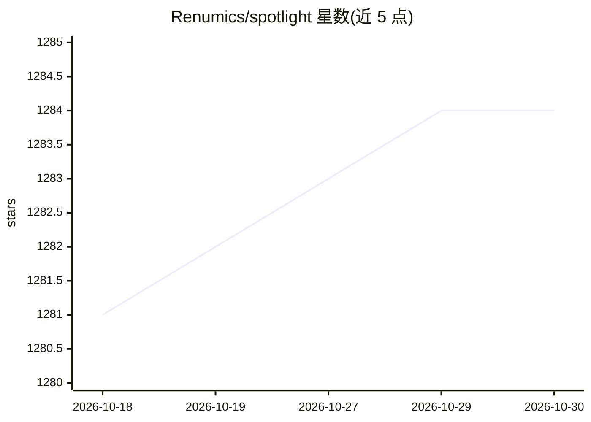

# Renumics/spotlight

⭐ 1,284 · TypeScript · MIT · 推送 2026-10-28 · [GitHub](https://github.com/Renumics/spotlight) · [官网](https://renumics.com) · 组织维护

**从 DataFrame 交互式探索非结构化数据集的浏览器可视化工具**

面向机器学习与工程团队的交互式数据探索工具：从 pandas DataFrame 或 Hugging Face datasets 出发，在浏览器中生成可视化视图，支持图像、音频、文本、视频、时间序列与几何数据类型，可利用嵌入、预测、不确定度等数据增强来识别关键簇。提供预定义布局用于模型调试（如 debug_classification），布局可编程或经 UI 构建。以 pip 安装的 Python 库形式提供，需 Python 3.10+；附带匿名崩溃与性能数据收集，可通过环境变量退出。

## 筛选速览

| 维度 | 判定 | 备注 |
|---|---|---|
| AI 角色 | `ai-ecosystem` | LLM/agent 周边工具 |
| 许可风险 | `permissive` | MIT |
| 部署形态 | `library` | 以包/库形式分发 |
| 模型依赖 | — | README 未给出锁定关系 |
| 硬件要求 | — | 无带数字的原话,不猜 |
| 安装摩擦 | `medium` | 含编译或系统依赖之一 |
| 成熟度 | — | 结构信号不足 |

## 能力要点

- 从 pandas/Hugging Face 数据集一键启动浏览器交互视图
- 支持图像、音频、文本、视频、时间序列、几何等非结构化类型
- 利用嵌入/预测/不确定度识别数据中的关键簇
- 预定义模型调试布局（debug_classification）

## 适用场景

- 在图像/音频/文本分类数据集中发现数据问题
- 对比预训练模型在数据集上的预测表现
- 结合嵌入对非结构化数据做探索性分析

## 场景标签

`数据分析` · 领域:效率与自动化

## 证据(README 行号)

> L10: Spotlight helps you to **understand unstructured datasets** fast. You can quickly create **interactive visualizatio
> L26: Machine learning and engineering teams use Spotlight to understand and communicate on complex unstructured data pro

## 星数曲线

2026-10-18 1,281 → 2026-10-30 1,284（+3）

---
*卡片 v1 · prompt 1.4 · 生成 2026-10-21 · 置信度 high · 依据 README sha `e31f13549c2d` · [字段定义](../../DATASET.md)*
