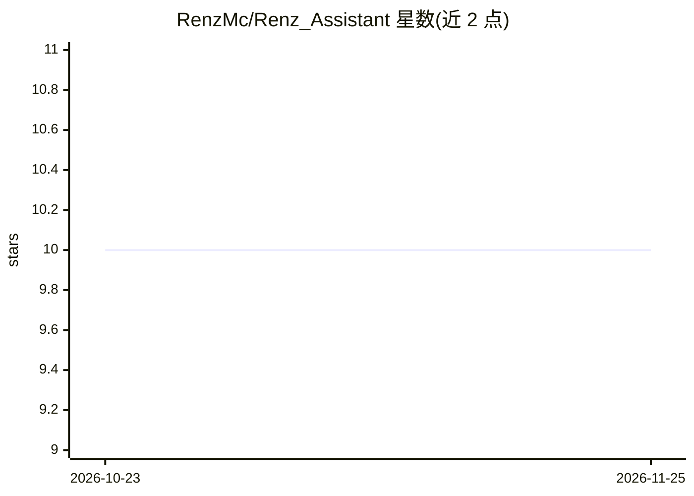

# RenzMc/Renz_Assistant

⭐ 10 · Python · 推送 2026-05-05 · [GitHub](https://github.com/RenzMc/Renz_Assistant) · 个人维护

**Termux 语音助手：Android 上语音控制设备并生成 AI 回答**

运行于 Android Termux 环境的模块化语音助手，通过 Termux:API 调用设备功能：语音识别支持 Termux API、Vosk 离线与 OpenAI Whisper 三种引擎，支持唤醒词与后台连续监听。对话能力通过 OpenRouter API key 接入，天气、AI 功能需联网。可控制亮度、音量、闪光灯、NFC、蓝牙、红外等，并管理短信、通话与通知；支持语音身份验证与多种人格风格，默认语言为印尼语。

## 筛选速览

| 维度 | 判定 | 备注 |
|---|---|---|
| AI 角色 | `ai-native` | 本体是模型或模型工具 |
| 许可风险 | `none` | — |
| 部署形态 | `library` | 以包/库形式分发 |
| 模型依赖 | locked-api |  |
| 硬件要求 | — | 无带数字的原话,不猜 |
| 安装摩擦 | `medium` | 含编译或系统依赖之一 |
| 成熟度 | — | 结构信号不足 |

## 能力要点

- 三种语音识别引擎（Termux API / Vosk 离线 / Whisper）
- 通过 OpenRouter API 接入 AI 对话
- 完整的 Termux:API 设备功能集成（NFC、红外、传感器等）
- 可定制唤醒词、睡眠词与助手人格

## 适用场景

- 在 Android 手机上用语音指令控制亮度、音量、闪光灯等设备功能
- 通过语音发送短信、拨打电话、查询天气
- 离线场景下使用 Vosk 进行本地语音识别
- 配置个性化助手人格与多语言交互

## 场景标签

`语音 Agent` · 领域:对话与助手

## 证据(README 行号)

> L3: An advanced modular voice assistant for Termux on Android devices with full Termux API integration.
> L11: - **AI-Powered Conversations**: Integration with OpenRouter API for intelligent responses

## 星数曲线

2026-10-23 10 → 2026-11-25 10（+0）

---
*卡片 v1 · prompt 1.4 · 生成 2026-11-20 · 置信度 high · 依据 README sha `4a6dd1f3043d` · [字段定义](../../DATASET.md)*
