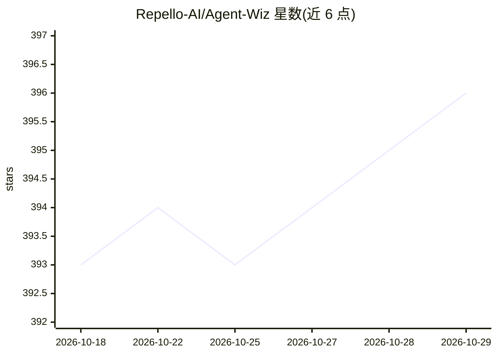

# Repello-AI/Agent-Wiz

⭐ — · [GitHub]() · 组织维护

**AI agent 工作流提取与威胁建模 CLI：可视化并安全评估**

Python 命令行工具，通过基于 AST 的静态解析从 LangGraph、AutoGen、CrewAI、LlamaIndex、n8n、OpenAI Agents 等 10 种编排框架代码中提取 agent 工作流，生成 JSON 图结构（节点/边、agent-to-agent 转移、工具调用链），并提供 d3 交互式可视化。支持按 MAESTRO 威胁建模框架生成威胁评估报告（分析步骤需配置 OpenAI API key）。STRIDE、PASTA 等模型在路线图中，尚未实现。

## 筛选速览

| 维度 | 判定 | 备注 |
|---|---|---|
| AI 角色 | `ai-ecosystem` | LLM/agent 周边工具 |
| 许可风险 | `permissive` | — |
| 部署形态 | `library` | 以包/库形式分发 |
| 模型依赖 | — | README 未给出锁定关系 |
| 硬件要求 | — | 无带数字的原话,不猜 |
| 安装摩擦 | `low` | 无编译、无系统依赖或容器化 |
| 成熟度 | — | 结构信号不足 |

## 能力要点

- 10 种主流 agent 框架的 AST 静态解析提取工作流
- 生成 JSON 图结构并输出 d3 交互式可视化
- 基于 MAESTRO 框架的自动化威胁评估报告
- CLI 三命令：extract / visualize / analyze

## 适用场景

- 对现有多 agent 系统代码做安全威胁评估
- 可视化复杂 agent 编排的调用链与数据流
- 安全团队生成 agent 工作流的威胁建模报告

## 场景标签

`网络安全` · 领域:学习与行业

## 证据(README 行号)

> L16: Agent Wiz is a Python CLI for **extracting agentic workflows** from popular AI frameworks and performing **automate
> L32: |**Automated Threat Assessment**|Generate comprehensive threat assessment report using established threat modeling 

## 星数曲线

2026-10-18 393 → 2026-10-29 396（+3）

---
*卡片 v1 · prompt 1.4 · 生成 2026-10-21 · 置信度 high · 依据 README sha `0ae40cf15c7b` · [字段定义](../../DATASET.md)*
