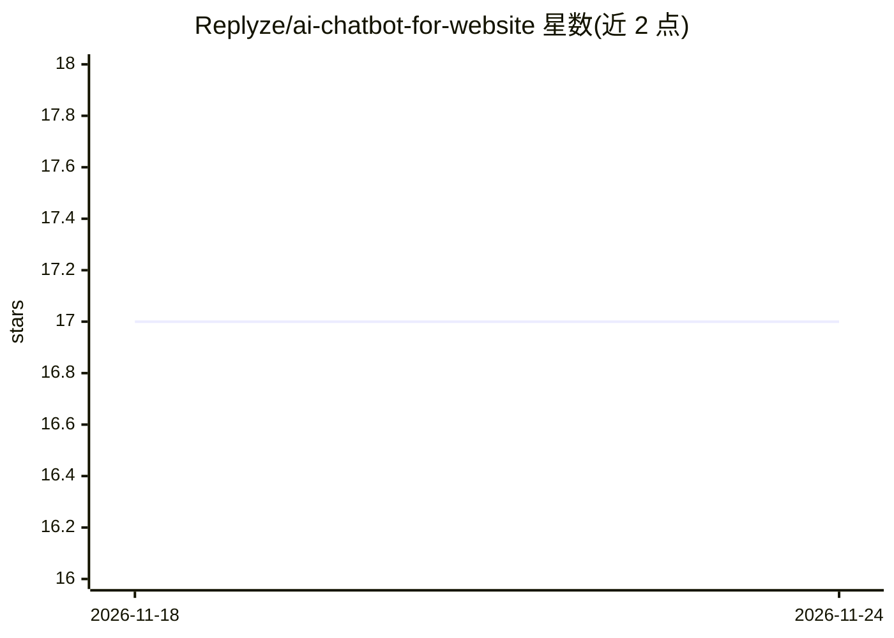

# Replyze/ai-chatbot-for-website

⭐ 17 · JavaScript · MIT · 推送 2026-11-13 · [GitHub](https://github.com/Replyze/ai-chatbot-for-website) · [官网](https://replyze.chat/?utm_source=github&utm_medium=referral&utm_campaign=ai-chatbot-for-website) · 组织维护

**面向网站/文档站的 AI 客服聊天机器人服务使用指南**

Replyze 维护的仓库，内容为如何在自己网站上部署由自有页面内容驱动的 AI 客服：注册账号后添加网站地址，爬虫读取 robots.txt、sitemap 与页面正文并按标题分节索引；访客提问时检索匹配片段作答，答案不可得时声明不知道并转人工。不重新训练模型。答案来源在 "Based on" 中列出，支持知识库文章、文件上传、教授答案、未答问题汇总与人工接管（web chat/邮件/WhatsApp/Telegram 统一收件箱）。提供可粘贴的网站挂件脚本，并附 Docusaurus、VitePress、MkDocs、Starlight、Nextra 的已测试代码。AI agent 功能属于付费计划。

## 筛选速览

| 维度 | 判定 | 备注 |
|---|---|---|
| AI 角色 | `ai-native` | 本体是模型或模型工具 |
| 许可风险 | `permissive` | MIT |
| 部署形态 | `library` | 以包/库形式分发 |
| 模型依赖 | — | README 未给出锁定关系 |
| 硬件要求 | — | 无带数字的原话,不猜 |
| 安装摩擦 | `low` | 无编译、无系统依赖或容器化 |
| 成熟度 | — | 结构信号不足 |

## 能力要点

- 爬取网站正文按标题分节索引，检索后仅从自有内容作答
- 每个答案列出所依据的页面/文章/文件（Based on）
- 答案缺失时明确说不知道并一键转人工，统一收件箱
- 未答问题按主题汇总并建议补写文章；支持教授正确答案

## 适用场景

- 我的网站/商店想要一个只根据自有页面回答访客的客服机器人
- 文档站（Docusaurus/VitePress 等）接入问答挂件
- 客服团队希望 AI 答不了的对话能带着上下文转给真人

## 场景标签

`聊天机器人` `文档问答` · 领域:对话与助手

## 证据(README 行号)

> L9: A practical guide to putting an AI chatbot on your website that answers visitors from your own pages: how it learns 
> L13: The examples use Replyze, AI customer support for websites: an AI agent that answers from your website and knowledg
> L38: "Trained on your pages" doesn't mean a model is retrained on your site. The chatbot reads your pages ahead of time,

## 星数曲线

2026-11-18 17 → 2026-11-24 17（+0）

---
*卡片 v1 · prompt 1.4 · 生成 2026-11-18 · 置信度 mid · 依据 README sha `425919820379` · [字段定义](../../DATASET.md)*
