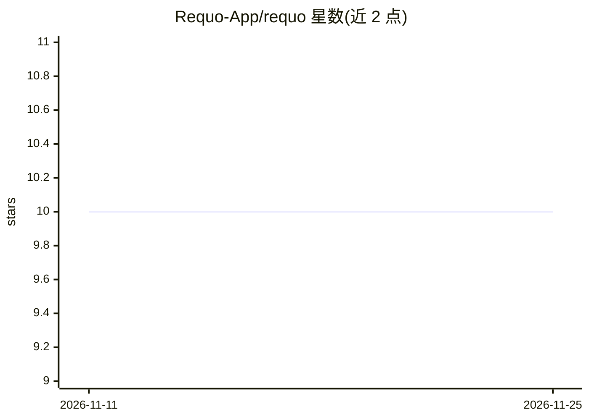

# Requo-App/requo

⭐ 10 · TypeScript · AGPL-3.0 · 推送 2026-11-19 · [GitHub](https://github.com/Requo-App/requo) · [官网](https://requo.app) · 个人维护

**服务型企业的一站式询价-报价-开票 SaaS，含 AI 助手**

面向服务型业主的开源自托管/云托管业务软件：公共受理页收集客户询价，从报价库生成可分享的报价页（接受/拒绝/修改），跟进邮件提醒，接受后转入发票并手工记录收款，附带分析、通知、成员角色与审计记录。AI 部分包括面向客户的公共 Agent 与面向业主的 Assistant 聊天，报价草稿基于业务知识文件生成，但模型不输出价格（由服务端从数据库回填）。不处理支付，AGPL-3.0 许可。

## 筛选速览

| 维度 | 判定 | 备注 |
|---|---|---|
| AI 角色 | `ai-enhanced` | 去掉 AI 部分产品仍成立 |
| 许可风险 | `viral` | AGPL-3.0 |
| 部署形态 | `library` | 以包/库形式分发 |
| 模型依赖 | — | README 未给出锁定关系 |
| 硬件要求 | — | 无带数字的原话,不猜 |
| 安装摩擦 | `low` | 无编译、无系统依赖或容器化 |
| 成熟度 | — | 结构信号不足 |

## 能力要点

- 询价→报价→发票全流程管理，报价页支持客户在线接受与签署
- AI Agent/Assistant 聊天须客户/业主确认后生效，模型报价不输出价格
- 自托管为完整部署形态，无订阅、计费与回连检查
- 免费层优先的多 AI 提供商路由，支持自定义 OpenAI 兼容后端

## 适用场景

- 服务型企业统一管理客户询价与报价跟进
- 向客户发送公开报价链接并在线接受
- 自托管独立部署替代订阅托管服务

## 场景标签

`AI 助手` · 领域:对话与助手

## 证据(README 行号)

> L5:  Inquiry-to-quote-to-invoice software for service businesses.
> L69: > **Agent vs Assistant:** the **Agent** is public customer-facing chat — its proposed inquiry needs customer confir
> L87: |AI|Vercel AI SDK with capacity-aware free-tier-first routing (Groq, Gemini, Cloudflare Workers AI, NVIDIA NIM, Ope

## 星数曲线

2026-11-11 10 → 2026-11-25 10（+0）

---
*卡片 v1 · prompt 1.4 · 生成 2026-11-20 · 置信度 high · 依据 README sha `e0e2e6793ec6` · [字段定义](../../DATASET.md)*
