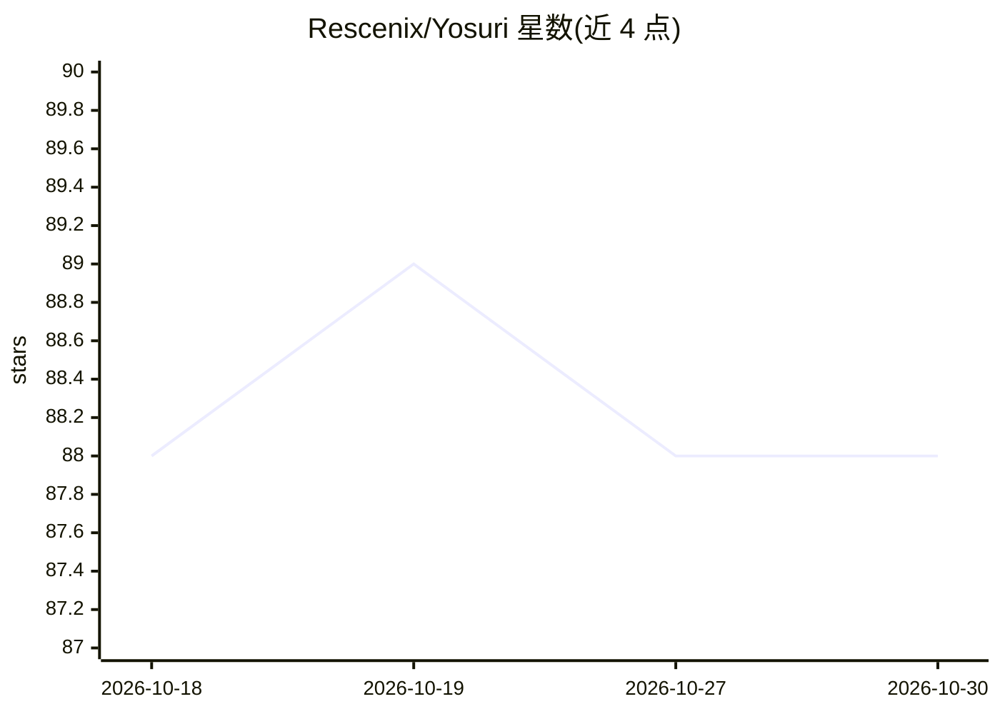

# Rescenix/Yosuri

⭐ 88 · Go · AGPL-3.0 · 推送 2026-09-24 · [GitHub](https://github.com/Rescenix/Yosuri) · [官网](https://www.yosuri.com) · 个人维护 · 中文 README

**本地优先的自进化 AI agent 工作台，聚合免费模型为统一 API**

用 Go + Vue 3 构建的跨平台 AI 工作台，覆盖 Windows/Linux/macOS/Android/CLI 五端同步，端到端加密同步会话与长期记忆。内置自动化循环（浏览器、终端、Computer Use），将 98 个免费模型与自定义供应商聚合为 OpenAI 与 Anthropic 兼容的单一端点并做智能路由。另提供子 agent 并发、后台记忆抽取为版本化事实账本、AgentFS 文件编辑审计、AI company 模式按阶段产出交付物（报告/Excel/UI/PPT/视频）。核心代码 AGPL-3.0，桌面端提供安装包，CLI 一行安装。

## 筛选速览

| 维度 | 判定 | 备注 |
|---|---|---|
| AI 角色 | `ai-native` | 本体是模型或模型工具 |
| 许可风险 | `viral` | AGPL-3.0 |
| 部署形态 | `library` | 以包/库形式分发 |
| 模型依赖 | — | README 未给出锁定关系 |
| 硬件要求 | — | 无带数字的原话,不猜 |
| 安装摩擦 | `low` | 无编译、无系统依赖或容器化 |
| 成熟度 | — | 结构信号不足 |

## 能力要点

- 98 个免费模型聚合为 OpenAI/Anthropic 兼容端点，带智能路由与故障转移
- 五平台同步（Windows/Linux/macOS/Android/CLI）+ E2E 加密记忆同步
- Computer Use、浏览器/终端工具链与 AgentFS 文件编辑快照/回滚
- 后台从对话抽取持久事实入版本化账本，按任务相关性注入

## 适用场景

- 让 agent 自主完成带工具执行与结果验证的自动化任务
- 在手机与桌面间无缝延续 AI 会话和项目记忆
- 免 API key 使用免费模型、网页搜索与视觉理解
- 一条指令让多 agent 产出完整交付物（文档/数据/UI/视频）

## 场景标签

`Agent 记忆` `多智能体` `GUI 自动化` `模型网关` · 领域:Agent 开发

## 证据(README 行号)

> L6:  A growing AI workbench — AI that remembers , executes , and keeps evolving
> L29: |**🔌 Aggregated API**|98 free models + custom providers unified behind one OpenAI & Anthropic-compatible endpoint, 

## 星数曲线

2026-10-18 88 → 2026-10-30 88（+0）

---
*卡片 v1 · prompt 1.4 · 生成 2026-10-23 · 置信度 mid · 依据 README sha `41317f092443` · [字段定义](../../DATASET.md)*
