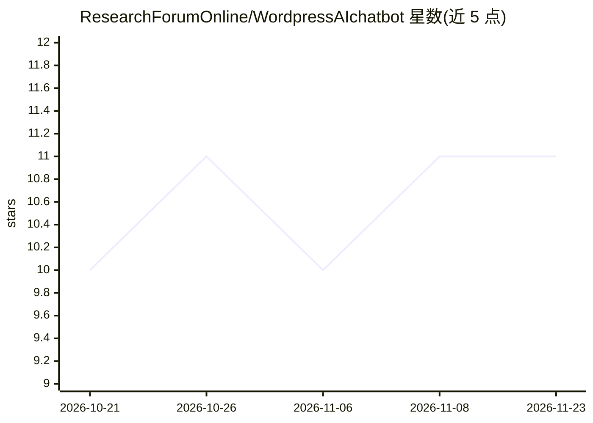

# ResearchForumOnline/WordpressAIchatbot

⭐ 11 · MIT · 推送 2026-07-04 · [GitHub](https://github.com/ResearchForumOnline/WordpressAIchatbot) · [官网](https://talktoai.org) · 个人维护

**可换品牌无需编码的 WordPress AI 聊天机器人插件**

一个 WordPress 插件，用于在网站上集成可定制的 AI 聊天机器人。通过 .zip 上传安装，在管理后台配置 API 提供商（OpenAI、Groq、Google Gemini，xAI Grok 为预留占位）、模型与 API key，无需编码。提供可编辑的 knowledgebase.txt（最大 10MB）作为上下文、agent-metadata.json 定义助手身份与欢迎语，以及本地预置问答回退以减少 API 调用。README 含大量宣传性表述，如'量子伦理决策框架'等术语未见可验证实现说明。

## 筛选速览

| 维度 | 判定 | 备注 |
|---|---|---|
| AI 角色 | `ai-native` | 本体是模型或模型工具 |
| 许可风险 | `permissive` | MIT |
| 部署形态 | `None` |  |
| 模型依赖 | locked-api |  |
| 硬件要求 | — | 无带数字的原话,不猜 |
| 安装摩擦 | `low` | 无编译、无系统依赖或容器化 |
| 成熟度 | — | 结构信号不足 |

## 能力要点

- 支持多 AI API 提供商，可在后台切换提供商与模型
- 可编辑知识库文件 knowledgebase.txt（最大 10MB）作为上下文
- agent-metadata.json 可定义助手人格、使命与欢迎语
- 本地回退问答机制减少 API 调用

## 适用场景

- 为 WordPress 网站添加品牌化的 AI 客服/聊天窗口
- 用自有知识库文本让聊天机器人回答领域问题
- 通过预置问答降低常见问题的 API 费用

## 场景标签

`聊天机器人` · 领域:对话与助手

## 证据(README 行号)

> L27: A comprehensive WordPress plugin for integrating customizable AI chatbots with support for multiple leading AI API 
> L52: A cutting-edge WordPress plugin designed for seamless integration of highly customizable AI chatbots. Agent Zero em
> L127: * **Multiple AI API Providers**: Seamlessly switch between popular AI services including OpenAI (GPT models), Groq

## 星数曲线

2026-10-21 10 → 2026-11-23 11（+1）

---
*卡片 v1 · prompt 1.4 · 生成 2026-11-18 · 置信度 high · 依据 README sha `6fc6ba3bc9d1` · [字段定义](../../DATASET.md)*
