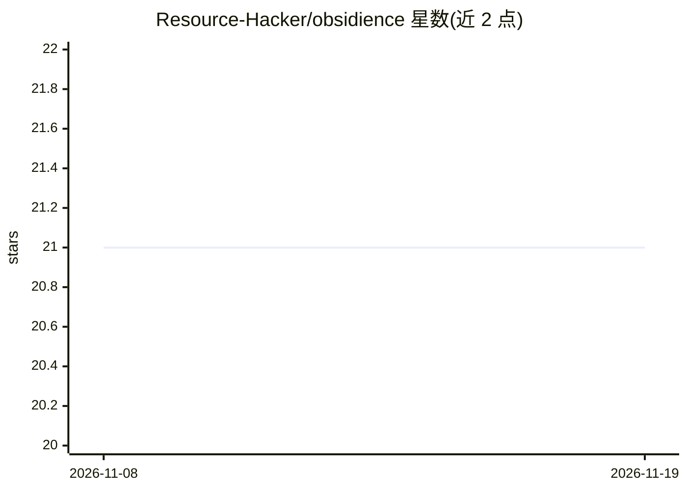

# Resource-Hacker/obsidience

⭐ 21 · Python · Apache-2.0 · 推送 2026-11-10 · [GitHub](https://github.com/Resource-Hacker/obsidience) · [官网](https://resource-hacker.github.io/obsidience/) · 组织维护

**本地优先的图原生 agent 框架与 Linux 桌面语音助手**

在本机运行 Executive Agent，以受维护的 Markdown wiki 与知识图谱（Article 即节点）代替提示堆；语音与聊天进入同一 ADK 会话循环，配套 Darwin/Alexandria/Heimdall 专职 Agent、Hindsight 每-Agent 记忆库与 Hyprland+Quickshell 桌面壳（实时 3D 图谱）。语音链路含 CPU 唤醒词、NeMo Nemotron 流式识别与 TTS；知识变更经 Review 与本地 Git 审计落地。开发机示例为 Gemma 4 26B-A4B 跑在 llama.cpp 双卡上。README 声明这是开发项目而非通用桌面安装器，安装与硬件验收由使用者负责。

## 筛选速览

| 维度 | 判定 | 备注 |
|---|---|---|
| AI 角色 | `ai-native` | 本体是模型或模型工具 |
| 许可风险 | `permissive` | Apache-2.0 |
| 部署形态 | `library` | 以包/库形式分发 |
| 模型依赖 | — | README 未给出锁定关系 |
| 硬件要求 | — | 无带数字的原话,不猜 |
| 安装摩擦 | `medium` | 含编译或系统依赖之一 |
| 成熟度 | `idea` | |

## 能力要点

- Article 即知识图谱节点，显式依赖而非相似度决定可运行内容
- 语音链路：CPU 唤醒词 + Nemotron 流式识别，Agent 预测话轮结束提前作答
- 变更经 Review 步骤与本地 Git 审计落地
- Hyprland + Quickshell 桌面壳以实时 3D 图谱展示 Agent 使用的 Article 与记忆

## 适用场景

- 在本机搭建带知识图谱与记忆的语音/聊天 Executive Agent
- 以可审计的 Markdown wiki 维护个人/项目知识并供 Agent 检索
- 在 Linux 桌面上以 3D 图谱观察 agent 的行动轨迹与记忆召回

## 场景标签

`Agent 框架` `语音 Agent` `Agent 记忆` `知识图谱` · 领域:Agent 开发

## 证据(README 行号)

> L13: Obsidience runs an Executive Agent on your own machine and gives it a maintained
> L140: - **Executive voice and chat.** Typed Chat and final speech transcripts enter
> L144:  spotter, NeMo/Nemotron streaming recognition and Pocket TTS; the Executive

## 星数曲线

2026-11-08 21 → 2026-11-19 21（+0）

---
*卡片 v1 · prompt 1.4 · 生成 2026-11-18 · 置信度 high · 依据 README sha `79617642d1b3` · [字段定义](../../DATASET.md)*
