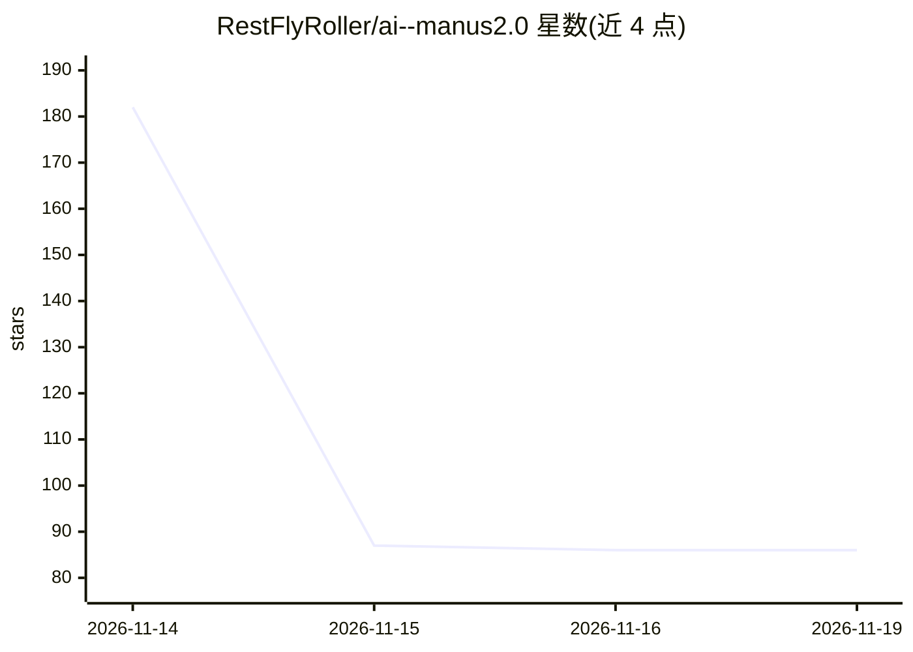

# RestFlyRoller/ai--manus2.0

⭐ 86 · Apache-2.0 · 推送 2026-11-15 · [GitHub](https://github.com/RestFlyRoller/ai--manus2.0) · 个人维护

**面向日常任务的自主 AI Agent：自动执行代码与浏览器操作**

README 描述的 Manus 是一个自主 AI Agent，可代用户编写并执行脚本、控制浏览器（打开网页、填表、收集信息）、执行多步骤任务，面向学习、家庭与轻量办公场景的用户，无需编程背景。README 说明其兼容性要求（最低双核 CPU、4 GB 内存）并给出准备、配置、测试、细化等使用步骤，但未提供任何具体的安装命令、代码仓库结构或模型接入方式（如 API key 配置）等技术细节。

## 筛选速览

| 维度 | 判定 | 备注 |
|---|---|---|
| AI 角色 | `ai-native` | 本体是模型或模型工具 |
| 许可风险 | `permissive` | Apache-2.0 |
| 部署形态 | `None` |  |
| 模型依赖 | — | README 未给出锁定关系 |
| 硬件要求 | — | 无带数字的原话,不猜 |
| 安装摩擦 | `low` | 无编译、无系统依赖或容器化 |
| 成熟度 | — | 结构信号不足 |

## 能力要点

- 自主执行代码与脚本，减少手工编写与调试
- 浏览器控制：导航网页、填写表单、收集信息
- 代码与浏览器操作可在同一任务流中衔接
- 面向家庭、学习与轻量办公的小规模任务

## 适用场景

- 让 agent 代为完成重复性的网页操作与数据收集
- 学习中运行小脚本、整理研究笔记
- 轻量办公中跨多个页面汇总信息

## 场景标签

`浏览器自动化` · 领域:效率与自动化

## 证据(README 行号)

> L10: - **Autonomous Code Execution:** Manus AI agent runs code on its own to complete tasks, so you can focus on decisio
> L18: Manus is an autonomous AI agent designed to run code and control a browser on your behalf. Instead of acting like a

## 星数曲线

2026-11-14 182 → 2026-11-19 86（-96）

---
*卡片 v1 · prompt 1.4 · 生成 2026-11-17 · 置信度 low · 依据 README sha `637da4fbcded` · [字段定义](../../DATASET.md)*
