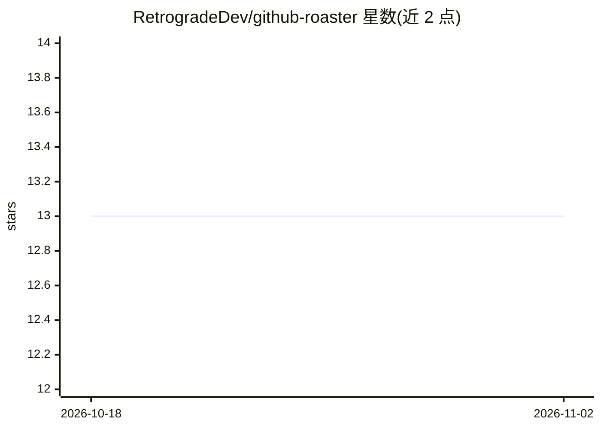

# RetrogradeDev/github-roaster

⭐ 13 · HTML · AGPL-3.0 · 推送 2026-05-28 · [GitHub](https://github.com/RetrogradeDev/github-roaster) · [官网](https://github-roaster.programordie.workers.dev/) · 个人维护

**用 LLM 吐槽 GitHub 用户资料的网页应用**

部署于 Cloudflare Workers 的网页应用：读取指定 GitHub 用户的公开资料与部分仓库信息，传入 LLM（llama 3.1）生成吐槽文本并展示给访问者。面向想被 AI 点评或本地运行该玩具项目的用户。本地运行需先安装 Wrangler CLI，用 npm create cloudflare 创建项目、复制 /src 代码后以 npx wrangler dev 运行，可部署到 Cloudflare。README 未说明 LLM API 的配置细节。

## 筛选速览

| 维度 | 判定 | 备注 |
|---|---|---|
| AI 角色 | `ai-native` | 本体是模型或模型工具 |
| 许可风险 | `viral` | AGPL-3.0 |
| 部署形态 | `library` | 以包/库形式分发 |
| 模型依赖 | — | README 未给出锁定关系 |
| 硬件要求 | — | 无带数字的原话,不猜 |
| 安装摩擦 | `low` | 无编译、无系统依赖或容器化 |
| 成熟度 | — | 结构信号不足 |

## 能力要点

- 抓取 GitHub 公开资料与仓库传给 llama 3.1 生成吐槽
- 基于 Cloudflare Workers/Wrangler 运行与部署
- 提供线上 Demo

## 适用场景

- 输入 GitHub 用户名获得一段 AI 生成的吐槽
- 作为 Cloudflare Workers + LLM 的小型示例项目本地运行

## 场景标签

`AI 写作` · 领域:内容生成

## 证据(README 行号)

> L2: This is a cool project that roasts GitHub users by fetching their public profile and some of their repositories and 

## 星数曲线

2026-10-18 13 → 2026-11-02 13（+0）

---
*卡片 v1 · prompt 1.4 · 生成 2026-10-31 · 置信度 high · 依据 README sha `a17f2b06effd` · [字段定义](../../DATASET.md)*
