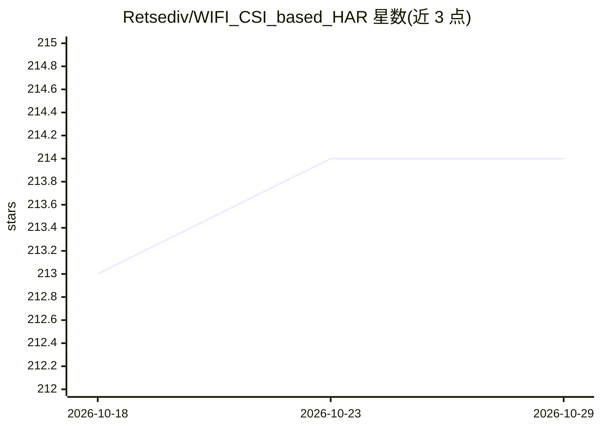

# Retsediv/WIFI_CSI_based_HAR

⭐ 214 · Jupyter Notebook · GPL-2.0 · 推送 2026-07-17 · [GitHub](https://github.com/Retsediv/WIFI_CSI_based_HAR) · 组织维护

**基于 WiFi CSI 的人体活动识别深度学习源码（论文配套）**

Ukrainian Catholic University 学位论文及配套论文的源码仓库，实现基于 Wi-Fi 信道状态信息（CSI）的人体活动识别（HAR）：包含 OpenWrt 路由器上发送数据包与计算 CSI 的 sendData/recvCSI 程序（经 UDP 回传）、数据可视化与保存服务，以及 LSTM 分类模型的构建与训练代码和标注脚本。论文工作含 8 项实验、3 个房间的数据集采集。给科研人员复现或研究 CSI 感知方案使用。

## 筛选速览

| 维度 | 判定 | 备注 |
|---|---|---|
| AI 角色 | `ai-native` | 本体是模型或模型工具 |
| 许可风险 | `viral` | GPL-2.0 |
| 部署形态 | `None` |  |
| 模型依赖 | — | README 未给出锁定关系 |
| 硬件要求 | — | 无带数字的原话,不猜 |
| 安装摩擦 | `low` | 无编译、无系统依赖或容器化 |
| 成熟度 | — | 结构信号不足 |

## 能力要点

- sendData/recvCSI 路由器端程序计算并通过 UDP 回传 CSI 数据
- 数据可视化服务器与模拟路由器数据的测试客户端
- LSTM 分类模型构建、训练与活动标注脚本
- 配套论文与学位论文（8 项实验、3 个房间数据集）

## 适用场景

- 复现基于 Wi-Fi CSI 的人体活动识别研究
- 采集并可视化路由器 CSI 数据
- 在自有数据集上训练 LSTM 活动分类模型

## 场景标签

`科研工具` · 领域:学习与行业

## 证据(README 行号)

> L3: This is a repository with source code for the paper "Human Activity Recognition based on Wi-Fi CSI Data - A Deep Neu
> L14: was collected, and LSTM-based classification model was build and trained. We’ve shown the full pipeline of building
> L28: - `model` - has all the code for building the model and training it, scripts that were used to label activities,

## 星数曲线

2026-10-18 213 → 2026-10-29 214（+1）

---
*卡片 v1 · prompt 1.4 · 生成 2026-10-22 · 置信度 mid · 依据 README sha `06c8455e5bca` · [字段定义](../../DATASET.md)*
