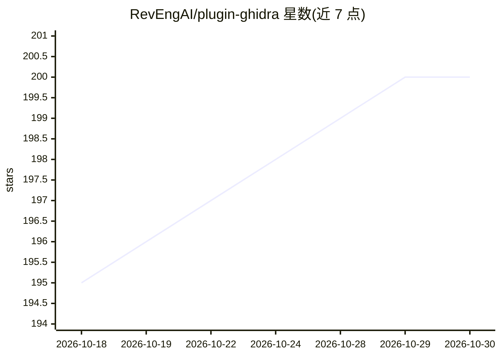

# RevEngAI/plugin-ghidra

⭐ 200 · Java · GPL-3.0 · 推送 2026-10-28 · [GitHub](https://github.com/RevEngAI/plugin-ghidra) · [官网](https://reveng.ai) · 组织维护

**给逆向工程师的 Ghidra 插件：接入 RevEng.AI 做二进制相似度与 AI 反编译**

RevEng.AI 官方开源的 Ghidra 扩展，通过 API 将当前打开的二进制上传至 RevEng.AI 平台分析，提供函数相似度匹配与重命名（单个或批量，最多返回 25 个候选）、AI 反编译及自然语言解释、Agent Chat 对话式重命名/改类型、与 Portal 双向同步等五个插件。需配置 RevEng.AI API key，支持 Ghidra 11.4+（Java 21），Releases 页提供预构建包，也可用 Gradle 自行构建。

## 筛选速览

| 维度 | 判定 | 备注 |
|---|---|---|
| AI 角色 | `ai-native` | 本体是模型或模型工具 |
| 许可风险 | `viral` | GPL-3.0 |
| 部署形态 | `desktop` | 安装包/桌面程序 |
| 模型依赖 | — | README 未给出锁定关系 |
| 硬件要求 | — | 无带数字的原话,不猜 |
| 安装摩擦 | `medium` | 含编译或系统依赖之一 |
| 成熟度 | — | 结构信号不足 |

## 能力要点

- 函数级与批量二进制相似度匹配并重命名（返回最多 25 个候选）
- AI 反编译窗口附函数功能自然语言解释
- Agent Chat 让 AI 重命名函数并修改类型
- 与 RevEng.AI Portal 双向同步名称、签名与数据类型

## 适用场景

- 逆向 stripped 二进制时恢复函数名
- 批量匹配并审阅候选名后统一重命名
- 让 AI 生成反编译结果并解释函数用途

## 场景标签

`网络安全` · 领域:学习与行业

## 证据(README 行号)

> L5: ### AI Assisted Binary Analysis
> L11: The RevEng.AI Ghidra plugins allows you to interact with our API from within Ghidra.
> L22: * AI Decompilation, with a natural language explanation of what the function does

## 星数曲线

2026-10-18 195 → 2026-10-30 200（+5）

---
*卡片 v1 · prompt 1.4 · 生成 2026-10-22 · 置信度 high · 依据 README sha `427f4d29f6e9` · [字段定义](../../DATASET.md)*
