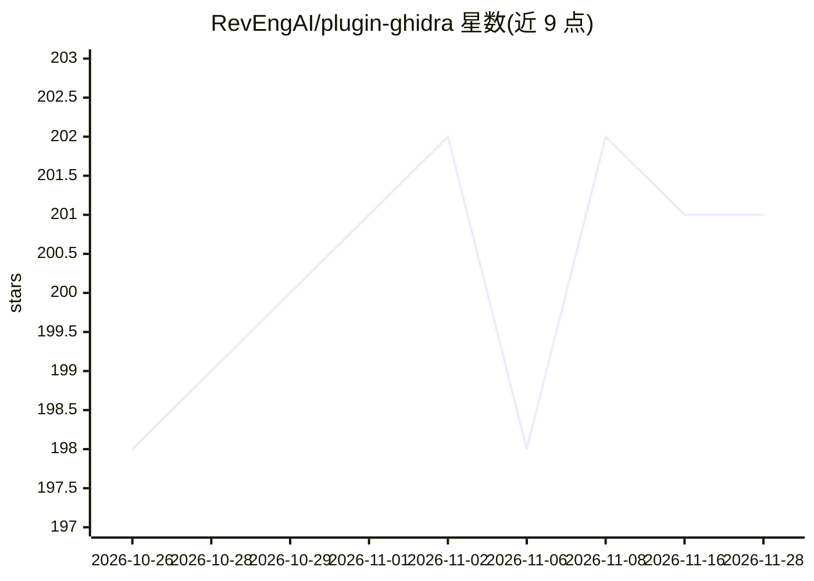

# RevEngAI/plugin-ghidra

⭐ 201 · Java · GPL-3.0 · 推送 2026-11-27 · [GitHub](https://github.com/RevEngAI/plugin-ghidra) · [官网](https://reveng.ai) · 组织维护

**逆向工程师在 Ghidra 内调用 RevEng.AI 做二进制分析**

Ghidra 扩展插件，通过 RevEng.AI API 在 Ghidra 内上传当前打开的二进制进行分析，用于剥离符号二进制的逆向辅助。关键机制包括：二进制代码相似度匹配并以匹配结果重命名函数（单个或批量）、跟随光标的相似函数窗口、AI 反编译附自然语言解释、Agent Chat 让 agent 重命名与重定类型函数、与 Portal 双向同步函数名/签名/数据类型。安装需 Ghidra 11.4+，自定义 Ghidra 版本需自行用 Gradle 构建。

## 筛选速览

| 维度 | 判定 | 备注 |
|---|---|---|
| AI 角色 | `ai-native` | 本体是模型或模型工具 |
| 许可风险 | `viral` | GPL-3.0 |
| 部署形态 | `desktop` | 安装包/桌面程序 |
| 模型依赖 | — | README 未给出锁定关系 |
| 硬件要求 | — | 无带数字的原话,不猜 |
| 安装摩擦 | `medium` | 含编译或系统依赖之一 |
| 成熟度 | — | 结构信号不足 |

## 能力要点

- 二进制代码相似度匹配并重命名函数（单个/批量，最多返回 25 个候选）
- AI 反编译并提供函数功能的自然语言解释
- Agent Chat 可询问当前二进制并自动重命名与重定类型函数
- 与 RevEng.AI Portal 双向同步名称、签名与数据类型

## 适用场景

- 逆向剥离符号的二进制时借助相似度匹配恢复函数名
- 在 Ghidra 内获得函数的 AI 反编译与自然语言说明
- 把 Portal 上的分析结果同步回本地并回传本地改名

## 场景标签

`网络安全` · 领域:学习与行业

## 证据(README 行号)

> L11: The RevEng.AI Ghidra plugins allows you to interact with our API from within Ghidra.
> L22: * AI Decompilation, with a natural language explanation of what the function does
> L23: * Agent Chat: ask the RevEng.AI agent about the current binary and let it rename and re-type functions

## 星数曲线

2026-10-26 198 → 2026-11-28 201（+3）

---
*卡片 v1 · prompt 1.4 · 生成 2026-11-25 · 置信度 high · 依据 README sha `510a841a5166` · [字段定义](../../DATASET.md)*
