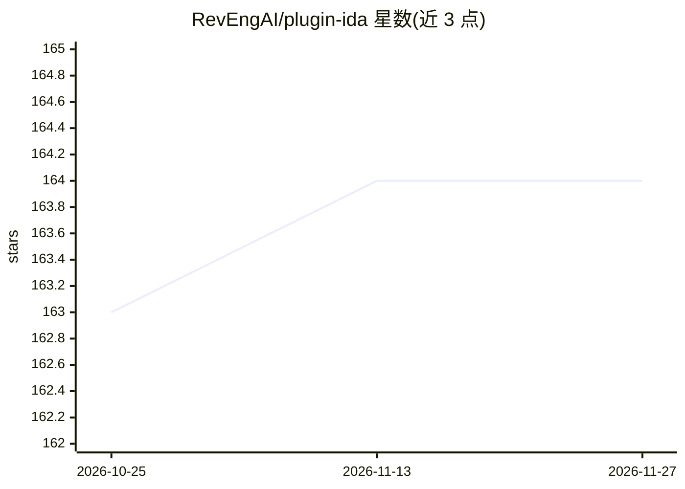

# RevEngAI/plugin-ida

⭐ 164 · Python · GPL-3.0 · 推送 2026-11-26 · [GitHub](https://github.com/RevEngAI/plugin-ida) · [官网](https://reveng.ai) · 组织维护

**逆向工程师在 IDA Pro 中调用 RevEng.AI API 分析二进制**

由 RevEng.ai 开源的 IDA Pro 插件，在 IDA 内与其 API 交互：上传当前打开的二进制进行分析，基于 Binary Code Similarity 为剥离符号的二进制恢复函数名。关键功能包括按置信度阈值自动重命名函数、显示相似函数、对选中函数生成 AI 反编译与自然语言解释，以及实验性的 Agent Chat（自然语言询问函数、反编译、重命名与跳转）。支持 IDA 9.0–9.5 与 Python 3.10–3.14，需配置 RevEng.AI Portal 的 API Key，README 提示 macOS + IDA 9.2 下不稳定。

## 筛选速览

| 维度 | 判定 | 备注 |
|---|---|---|
| AI 角色 | `ai-native` | 本体是模型或模型工具 |
| 许可风险 | `viral` | GPL-3.0 |
| 部署形态 | `desktop` | 安装包/桌面程序 |
| 模型依赖 | — | README 未给出锁定关系 |
| 硬件要求 | — | 无带数字的原话,不猜 |
| 安装摩擦 | `low` | 无编译、无系统依赖或容器化 |
| 成熟度 | `idea` | |

## 能力要点

- 上传二进制至 RevEng.AI API 进行分析与函数名恢复
- AI 反编译选中函数并附自然语言功能解释
- Agent Chat（实验性）：对话式查询、反编译、重命名并跳转函数
- 支持 IDA 9.0–9.5 与 Python 3.10–3.14

## 适用场景

- 对剥离符号的二进制批量恢复函数名
- 在 IDA 中查看选中函数的 AI 反编译与解释
- 通过对话让 agent 代为反编译并重命名函数

## 场景标签

`网络安全` · 领域:学习与行业

## 证据(README 行号)

> L11: The RevEng.AI IDA plugins allows you to interact with our API from within IDA.
> L13: and use it for Binary Code Similarity to help you Reverse Engineer stripped binaries.
> L22: * AI Decompilation of selected functions

## 星数曲线

2026-10-25 163 → 2026-11-27 164（+1）

---
*卡片 v1 · prompt 1.4 · 生成 2026-11-27 · 置信度 mid · 依据 README sha `d2d12ef9ec0a` · [字段定义](../../DATASET.md)*
