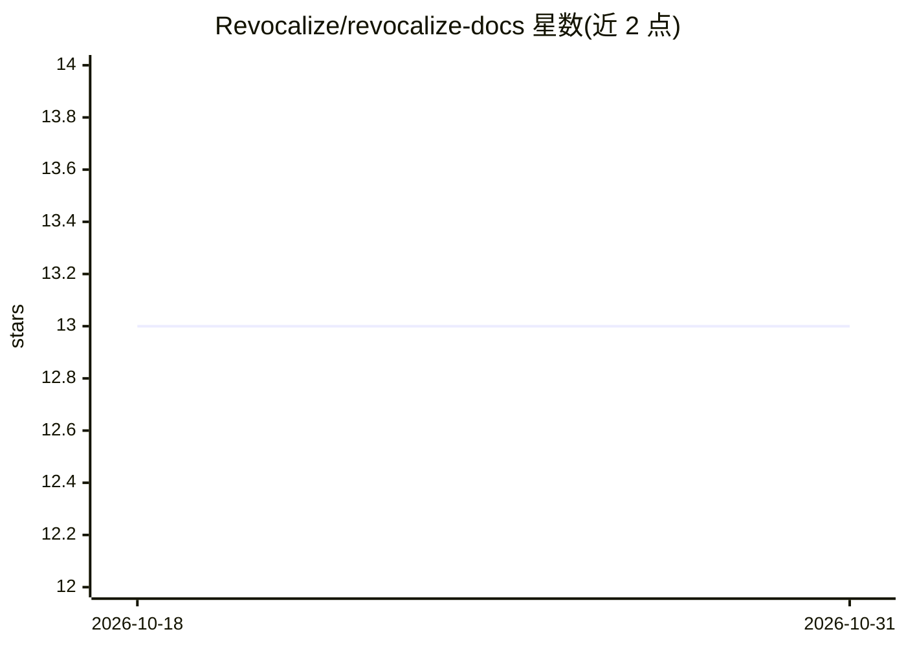

# Revocalize/revocalize-docs

⭐ 13 · MDX · 推送 2026-10-13 · [GitHub](https://github.com/Revocalize/revocalize-docs) · [官网](https://docs.revocalize.ai) · 组织维护

**Revocalize AI 歌声合成 API 的官方文档仓库**

Revocalize AI 官方 API 文档：提供歌声转换、AI 声音模型创建与训练等 REST 端点，用户以 Bearer API Key 认证，上传 WAV 人声与训练音频，生成/训练自定义声音模型并输出转换后的演唱音频。功能包括跨语言保留口音音色、情感范围、实时 Auto Tune、自动生成变体与音量/音调/速度调节。面向开发者、艺术家与音乐制作人，属云端付费 API 服务文档（MIT 许可仅指本仓库）。文档版权声明禁止未经授权复制。

## 筛选速览

| 维度 | 判定 | 备注 |
|---|---|---|
| AI 角色 | `ai-native` | 本体是模型或模型工具 |
| 许可风险 | `permissive` | — |
| 部署形态 | `None` |  |
| 模型依赖 | — | README 未给出锁定关系 |
| 硬件要求 | — | 无带数字的原话,不猜 |
| 安装摩擦 | `low` | 无编译、无系统依赖或容器化 |
| 成熟度 | — | 结构信号不足 |

## 能力要点

- POST /convert 将 WAV 人声转换为指定声音模型演唱
- 创建并用训练音频训练自定义 AI 声音模型（可设 epochs）
- 跨语言保留口音音调、情感表达、实时 Auto Tune、语音调制
- Bearer Token 认证与 ping 端点连通性测试

## 适用场景

- 我把自己的演唱转换成训练好的 AI 声音模型
- 音乐制作人用自有音频数据训练定制歌声模型
- 开发者将歌声转换功能集成到音频制作工作流

## 场景标签

`语音合成` · 领域:内容生成

## 证据(README 行号)

> L52: This endpoint takes a WAV vocal audio file and returns a URL string with the converted vocals audio file.
> L66: This endpoint creates a new AI voice model, which is initially created in a pending state. You must train the model
> L79: Train a custom AI voice model after creating it in a pending state.

## 星数曲线

2026-10-18 13 → 2026-10-31 13（+0）

---
*卡片 v1 · prompt 1.4 · 生成 2026-10-31 · 置信度 high · 依据 README sha `1e7017483b5d` · [字段定义](../../DATASET.md)*
