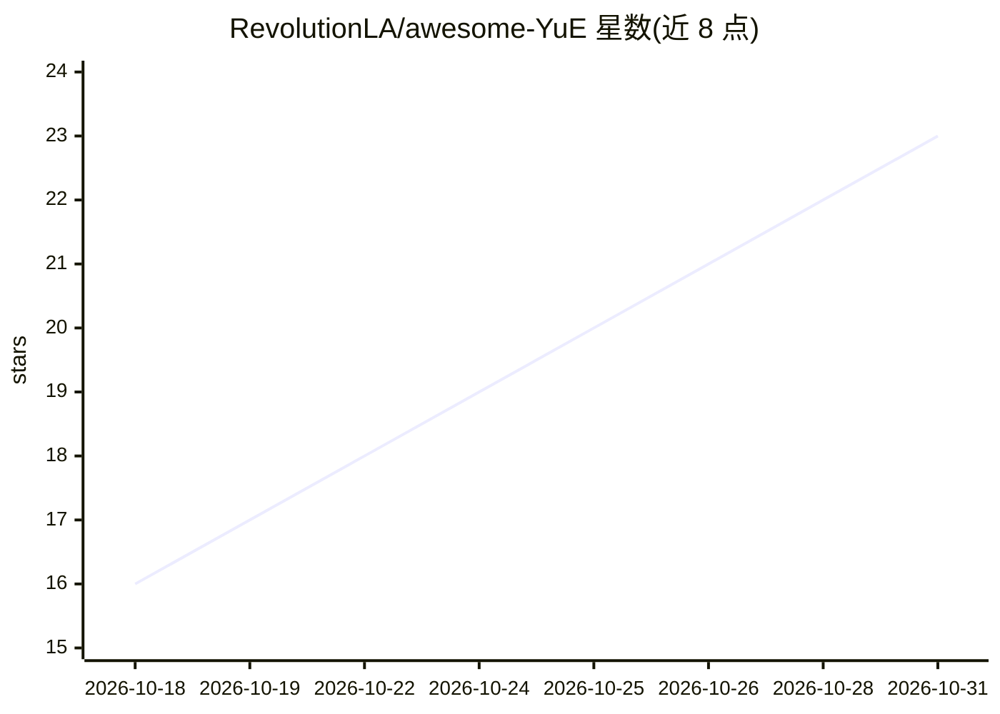

# RevolutionLA/awesome-YuE

⭐ 23 · Python · NOASSERTION · 推送 2026-10-24 · [GitHub](https://github.com/RevolutionLA/awesome-YuE) · [官网](https://github.com/RevolutionLA/awesome-YuE) · 个人维护 · 中文 README

**YuE/YuE2 开源音乐生成生态精选清单（99 条，78 个项目）**

围绕 m-a-p 团队开源全曲音乐生成模型 YuE / YuE2 的社区生态策展清单，中文优先，收录 99 条资源（78 个 GitHub 项目及模型权重、教程、云服务），覆盖图形界面、GGUF/C++ 量化运行时、Mac/MLX 与移动端移植、ComfyUI 节点、LoRA 训练、DAW 音乐制作工具链与教程。提供按显存与平台对号入座的快速选择表，链接由每周自动巡检维护。条目覆盖的本地运行方式以 audio.cpp / yue2.cpp（GGML）与 MLX 为主，清单本身 CC0-1.0 许可，被收录模型权重多为 CC BY-NC 4.0（非商用）。

## 筛选速览

| 维度 | 判定 | 备注 |
|---|---|---|
| AI 角色 | `ai-knowledge` | 知识聚合/清单类 |
| 许可风险 | `none` | NOASSERTION |
| 部署形态 | `None` |  |
| 模型依赖 | — | README 未给出锁定关系 |
| 硬件要求 | — | 无带数字的原话,不猜 |
| 安装摩擦 | `medium` | 含编译或系统依赖之一 |
| 成熟度 | — | 结构信号不足 |

## 能力要点

- 收录 99 条资源（78 个 GitHub 项目 + 权重/教程/云服务），按 16 类组织
- 按显存（8GB/12–16GB/24GB+）与平台（Windows/Mac/iPhone/Android）提供快速选择表
- 覆盖 GUI、量化运行时、ComfyUI 节点、LoRA 训练、DAW/VST 集成等类别
- 链接有效性由每周自动巡检守护

## 适用场景

- 想跑 YuE2 但不知道选哪个运行时或量化方案时查表选型
- 为 ComfyUI 工作流查找 YuE2 节点包与工作流模板
- 寻找 Mac/MLX 或手机端本地运行 YuE2 的移植项目
- 了解 YuE2 的 LoRA 训练与音乐制作工具链生态

## 场景标签

`精选清单` · 领域:学习与行业

## 证据(README 行号)

> L16: YuE（乐）是 m-a-p 团队开源的全曲音乐生成基础模型（lyrics2song），可以只凭歌词与风格提示生成几分钟长的完整歌曲（人声 + 伴奏），被视为开源版 Suno。自 2025 年 1 月发布以来，社区涌现了大量界面、量
> L20: > 📊 **收录 99 条（78 个 GitHub 项目 + 模型权重/教程/云服务）** · 最近更新见 提交历史 · 链接有效性由 每周自动巡检 守护
> L24: ## 📑 目录

## 星数曲线

2026-10-18 16 → 2026-10-31 23（+7）

---
*卡片 v1 · prompt 1.4 · 生成 2026-10-28 · 置信度 high · 依据 README sha `fddb0e4a1a2f` · [字段定义](../../DATASET.md)*
