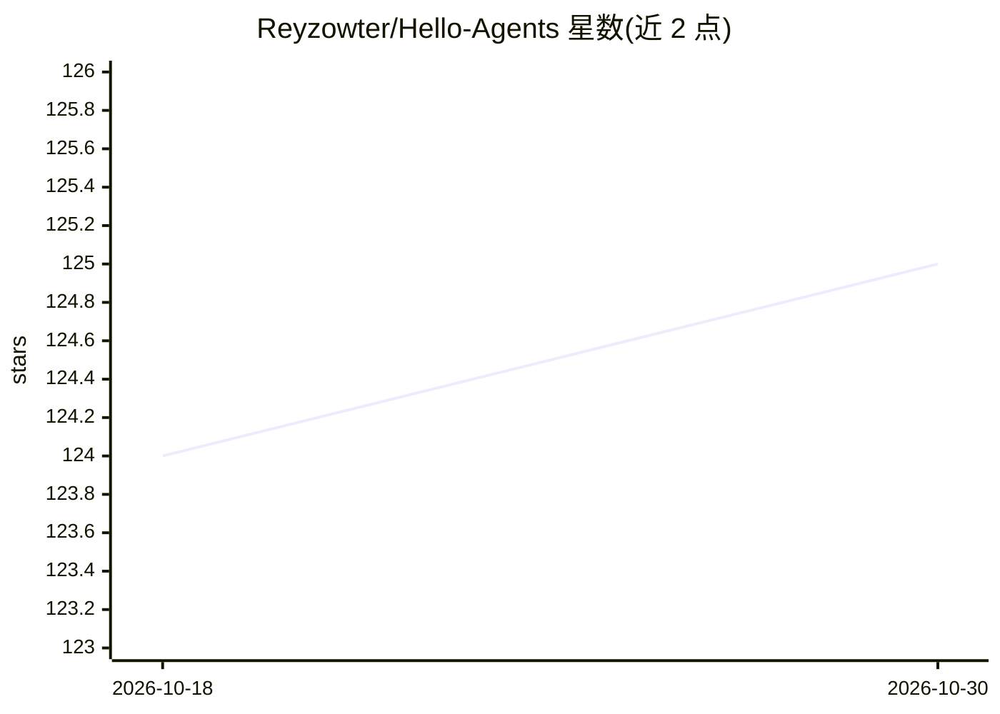

# Reyzowter/Hello-Agents

⭐ 125 · Python · 推送 2026-06-23 · [GitHub](https://github.com/Reyzowter/Hello-Agents) · [官网](http://helloagents.org/) · 组织维护

**AI Agent 系统从零构建的开源教程课程**

面向 AI 开发者、学生与求职者的开源教程仓库：以 5 部分、16 章的结构讲解 Agent 与 LLM 基础、经典范式（ReAct/Plan-and-Solve/Reflection）实现、记忆与 RAG、MCP/A2A/ANP 协议、Agentic-RL 训练管线与评测，并含旅行助手、DeepResearch 复现等实战案例。每章附 /code 目录下可运行代码，另设 14 个社区扩展章节（面试题、GUI/Web Agent 等）。提供在线阅读、本地克隆与 PDF 三种使用方式。

## 筛选速览

| 维度 | 判定 | 备注 |
|---|---|---|
| AI 角色 | `ai-knowledge` | 知识聚合/清单类 |
| 许可风险 | `none` | — |
| 部署形态 | `None` |  |
| 模型依赖 | — | README 未给出锁定关系 |
| 硬件要求 | — | 无带数字的原话,不猜 |
| 安装摩擦 | `low` | 无编译、无系统依赖或容器化 |
| 成熟度 | — | 结构信号不足 |

## 能力要点

- 5 部分 16 章的课程结构，覆盖基础到生产级多 Agent 应用
- 从零实现完整 Agent 框架与经典范式（ReAct 等）
- MCP/A2A/ANP 通信协议深入讲解
- 每章附带经过测试的可运行代码（/code 目录）

## 适用场景

- 系统学习从 LLM 基础到多 Agent 系统的完整知识体系
- 动手从零实现 Agent 框架与 ReAct 等范式
- 准备 AI 工程师岗位的 Agent 面试题
- 参考旅行助手、DeepResearch 等实战案例构建自己的应用

## 场景标签

`教程课程` · 领域:学习与行业

## 证据(README 行号)

> L24: This is a complete, open-source curriculum that takes you from zero to building production-grade multi-agent system
> L63: ├── Part 1: Agent & LLM Fundamentals        (Chapters 1–3)

## 星数曲线

2026-10-18 124 → 2026-10-30 125（+1）

---
*卡片 v1 · prompt 1.4 · 生成 2026-10-23 · 置信度 high · 依据 README sha `354b6a2de729` · [字段定义](../../DATASET.md)*
