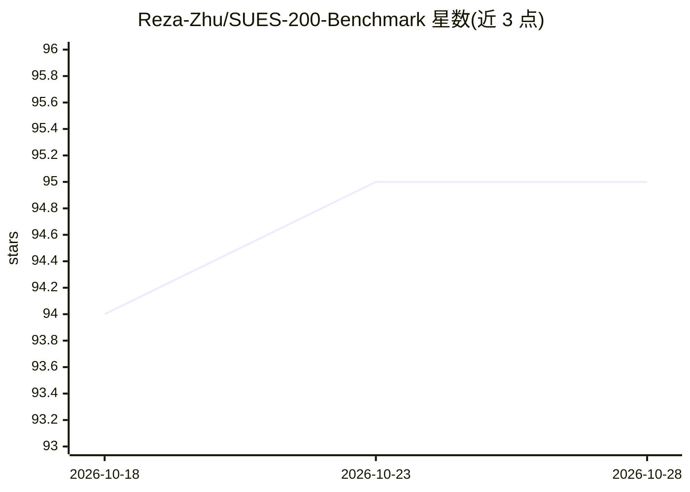

# Reza-Zhu/SUES-200-Benchmark

⭐ 95 · Python · MIT · 推送 2026-09-08 · [GitHub](https://github.com/Reza-Zhu/SUES-200-Benchmark) · 个人维护 · 中文 README

**无人机与卫星跨视角图像匹配基准数据集与评测流水线**

面向 UAV/无人机与卫星图像跨视角匹配研究的数据集与基准仓库：提供 150/200/250/300 米四个飞行高度、多场景的成对数据（经 Google Drive、百度网盘、天翼云分发），并附带双分支基线模型（ResNet、ViT、LPN、VGG、DenseNet、EfficientNet 等骨干）与端到端流水线，覆盖数据准备（符号链接布局）、训练、特征提取与双向检索评测（Recall@K、AP）。评测支持分块批量检索、三种距离度量、鲁棒性与多查询池化等可选评估。数据集与权重仅限学术研究使用。

## 筛选速览

| 维度 | 判定 | 备注 |
|---|---|---|
| AI 角色 | `ai-knowledge` | 知识聚合/清单类 |
| 许可风险 | `permissive` | MIT |
| 部署形态 | `library` | 以包/库形式分发 |
| 模型依赖 | — | README 未给出锁定关系 |
| 硬件要求 | — | 无带数字的原话,不猜 |
| 安装摩擦 | `medium` | 含编译或系统依赖之一 |
| 成熟度 | — | 结构信号不足 |

## 能力要点

- 四飞行高度（150–300 米）多场景的无人机-卫星成对数据
- 双分支基线覆盖 ResNet/ViT/LPN/VGG/DenseNet/EfficientNet 等骨干
- 端到端流水线：数据准备、训练、特征提取与双向检索评测
- 可选评估：雨雾雪等鲁棒性测试与多查询池化

## 适用场景

- 在标准基准上复现并比较跨视角图像匹配方法
- 训练并评测无人机到卫星（及反向）的图像检索模型
- 研究不同飞行高度与扰动条件对匹配的影响

## 场景标签

`模型评测` · 领域:评测与运维

## 证据(README 行号)

> L18: SUES-200 is a benchmark for matching UAV/drone images with satellite images
> L25: > SUES-200 is available for academic research only. Please follow the dataset
> L46: - Baidu Pan: `https://pan.baidu.com/s/1mrd-7ADm57_OchAvO1XmNw` · 提取码：`p836`

## 星数曲线

2026-10-18 94 → 2026-10-28 95（+1）

---
*卡片 v1 · prompt 1.4 · 生成 2026-10-23 · 置信度 mid · 依据 README sha `bba9d071e882` · [字段定义](../../DATASET.md)*
