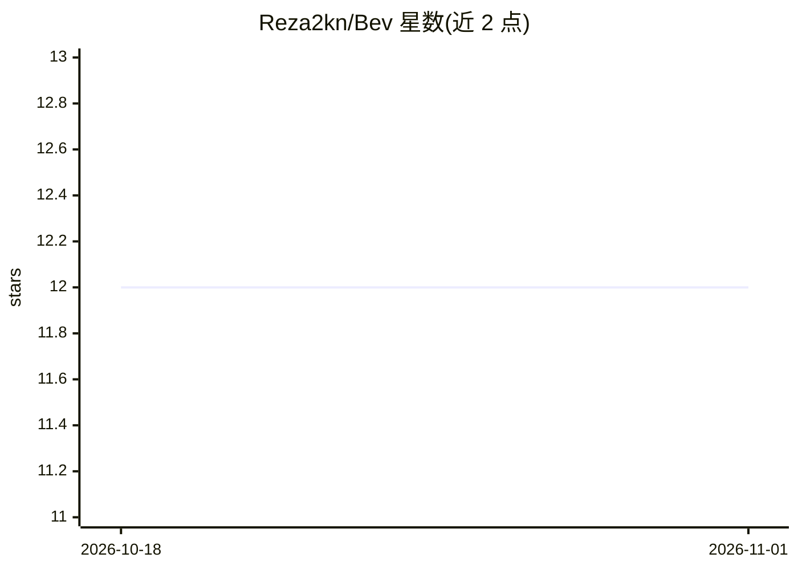

# Reza2kn/Bev

⭐ 12 · Python · MIT · 推送 2026-09-23 · [GitHub](https://github.com/Reza2kn/Bev) · [官网](https://huggingface.co/Reza2kn/Bev) · 个人维护

**面向开发者的三元决策评分推理服务：本地 HTTP API 输出结构化决策**

基于 Prism ML 的 Ternary-Bonsai-2-27B 三元权重（7.21 GB GGUF 原样再分发）的推理包，非新训练模型：输入上下文与 2–255 个候选，通过每字段一次 next-token 评分对候选打分并返回类型化 JSON（Choice/Noul/Score/枚举/布尔），经 127.0.0.1:18781 本地 API 提供。要求 Prism fork 的 llama.cpp 运行时，Linux CUDA 与 Apple Silicon Metal 路径已验证，CPU-only 建议至少 16 GB 内存，Windows 源码构建路径未测试。附波斯语基准评测（95.42% Choice）及复现工具。

## 筛选速览

| 维度 | 判定 | 备注 |
|---|---|---|
| AI 角色 | `ai-native` | 本体是模型或模型工具 |
| 许可风险 | `permissive` | MIT |
| 部署形态 | `None` |  |
| 模型依赖 | local-ok | 支持本地模型 |
| 硬件要求 | `cpu-ok` | |
| 安装摩擦 | `medium` | 含编译或系统依赖之一 |
| 成熟度 | — | 结构信号不足 |

## 能力要点

- 每字段一次 next-token 评分，返回含候选概率与原始 log 概率的类型化 JSON
- 支持 Choice/Noul/Score/枚举/布尔，2–255 候选，经加载 tokenizer 校验
- Linux CUDA 与 Apple Silicon Metal 路径已验证；CPU-only 起步建议 16 GB RAM
- 含波斯语基准复现评测工具（624/624 有效答案）

## 适用场景

- 为客服分流等场景从有限候选中做结构化决策打分
- 在本地部署决策评分 API 并获取候选概率
- 复现波斯语决策基准评测

## 场景标签

`推理引擎` · 领域:训练与推理

## 证据(README 行号)

> L10: Bev runs Jevfire-style decision scoring on Prism ML's Ternary-Bonsai-2-27B. Give it context and a finite set of cho
> L12: **Bev is an inference package, not a newly trained model.** The 7.21 GB GGUF is the original Prism file, redistribu

## 星数曲线

2026-10-18 12 → 2026-11-01 12（+0）

---
*卡片 v1 · prompt 1.4 · 生成 2026-11-01 · 置信度 high · 依据 README sha `7a683aa13a74` · [字段定义](../../DATASET.md)*
