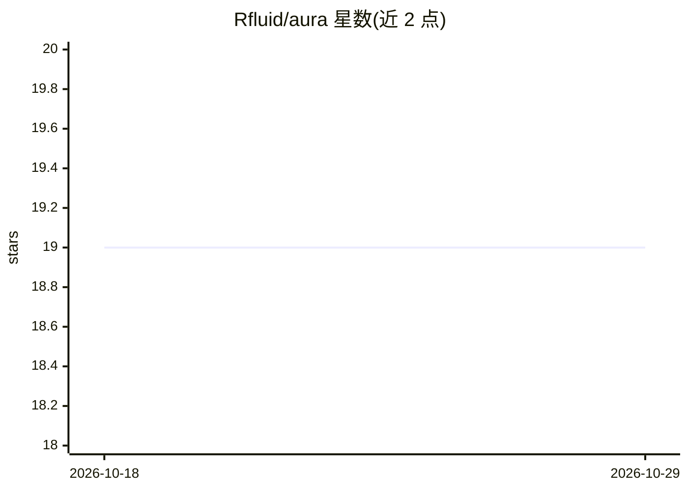

# Rfluid/aura

⭐ 19 · Rust · 推送 2026-10-26 · [GitHub](https://github.com/Rfluid/aura) · 个人维护

**系统托盘 AI agent 用量指示器：实时显示 token 与配额**

用 Rust 编写的系统托盘指示应用，面向在开发工作流中运行 AI agent 的个人用户。它读取 Claude Code、Codex、Gemini、Antigravity 等 agent 的用量数据，在托盘图标环上实时显示当前会话与周配额占比，并通过弹窗提供配额窗口、用量预测、汇总统计与分模型 token 明细。支持多 agent 配置文件切换、TOML 热重载配置、vim 风格快捷键、主题自定义，以及以独立可执行文件形式存在的插件系统（首个官方插件展示 RTK 优化器节省的 token）。另提供可脚本化的 headless CLI 子命令。Linux/macOS/Windows 均提供安装方式并默认配置自启动。

## 筛选速览

| 维度 | 判定 | 备注 |
|---|---|---|
| AI 角色 | `ai-ecosystem` | LLM/agent 周边工具 |
| 许可风险 | `none` | — |
| 部署形态 | `desktop` | 安装包/桌面程序 |
| 模型依赖 | — | README 未给出锁定关系 |
| 硬件要求 | — | 无带数字的原话,不猜 |
| 安装摩擦 | `medium` | 含编译或系统依赖之一 |
| 成熟度 | — | 结构信号不足 |

## 能力要点

- 托盘图标环实时显示会话/周配额，颜色随用量分档变化
- 支持 Claude Code、Codex、Gemini、Antigravity 等多种 agent 与多配置文件切换
- 插件系统以独立可执行文件向弹窗注入自定义 JSON 指标面板
- headless CLI 子命令（usage/quota/doctor 等）可脚本化，输出 text|json

## 适用场景

- 我不用切上下文就能在系统托盘看到 AI agent 的 token 消耗与订阅配额
- 我配置多个 agent 配置文件，在个人与企业工作区之间一键切换
- 我用 CLI 输出 JSON 把用量数据接进自己的脚本

## 场景标签

 · 领域:AI 开发者工具/用量分析

## 证据(README 行号)

> L10: Aura is a lightweight Rust **system-tray indicator** — sits next to wifi
> L61: Modern development workflows run on AI agents. But usage is invisible
> L68: - **Multi-agent support** — Claude Code, Codex, Gemini, and Antigravity out of the box; custom command agents on th

## 星数曲线

2026-10-18 19 → 2026-10-29 19（+0）

---
*卡片 v1 · prompt 1.4 · 生成 2026-10-28 · 置信度 high · 依据 README sha `3e701ba2505e` · [字段定义](../../DATASET.md)*
