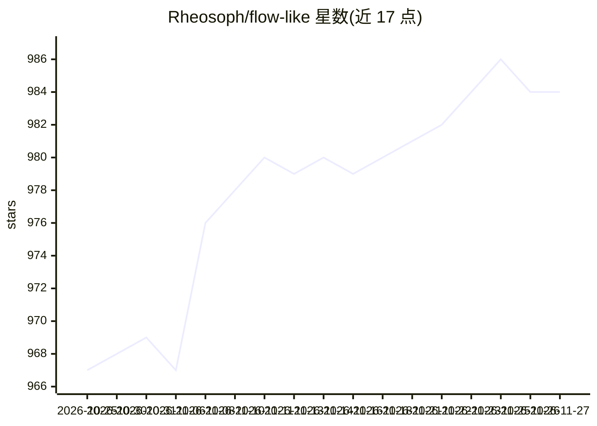

# Rheosoph/flow-like

⭐ 984 · Rust · NOASSERTION · 推送 2026-11-26 · [GitHub](https://github.com/Rheosoph/flow-like) · [官网](https://flow-like.com) · 组织维护

**自托管低代码工作流平台：构建应用、自动化、数据与 AI 集成**

Flow-Like 是一个可自托管的开发平台，将界面、工作流与数据组合为应用：提供 1,900+ 内置类型化节点，覆盖 SQL、API、文档、媒体、UI、桌面自动化、AI 与机器学习；通过 Package 打包自定义节点与 UI 组件；同一工作流可用画布或 FlowScript 文本编辑。架构为 Rust 执行引擎 + Tauri 桌面客户端（Studio）+ TypeScript/React 界面，支持本地执行与 Docker Compose/Kubernetes 共享后端，源码以 BSL 1.1 提供。

## 筛选速览

| 维度 | 判定 | 备注 |
|---|---|---|
| AI 角色 | `ai-enhanced` | 去掉 AI 部分产品仍成立 |
| 许可风险 | `none` | NOASSERTION |
| 部署形态 | `self-host` | docker 或自建部署 |
| 模型依赖 | — | README 未给出锁定关系 |
| 硬件要求 | — | 无带数字的原话,不猜 |
| 安装摩擦 | `low` | 无编译、无系统依赖或容器化 |
| 成熟度 | — | 结构信号不足 |

## 能力要点

- 1,900+ 类型化内置节点与可复用 Package 机制
- Rust 执行引擎 + Tauri 桌面客户端 + TypeScript/React 界面
- 画布与 FlowScript 文本编辑同一 Board，支持代码评审
- Docker Compose 与 Kubernetes 自托管路径，捆绑 PostgreSQL/Redis/RustFS

## 适用场景

- 把内部系统的数据与操作封装成团队可用的操作台
- 搭建文档抽取、校验与人工复核的流程
- 构建可调用工具和知识的 AI 助手应用
- 通过 OPC UA/Modbus/MQTT 做设备与桌面自动化

## 场景标签

`工作流自动化` `GUI 自动化` `AI 助手` · 领域:效率与自动化

## 证据(README 行号)

> L8:  A self-hostable development platform for apps, automation, data, and AI.
> L25: Build with **1,900+ built-in nodes**, typed building blocks for your
> L109: |**An assistant that can act**|Retrieve knowledge, call tools, and return results through chat or an application u

## 星数曲线

2026-10-25 967 → 2026-11-27 984（+17）

---
*卡片 v1 · prompt 1.4 · 生成 2026-11-24 · 置信度 high · 依据 README sha `e5118dee1689` · [字段定义](../../DATASET.md)*
