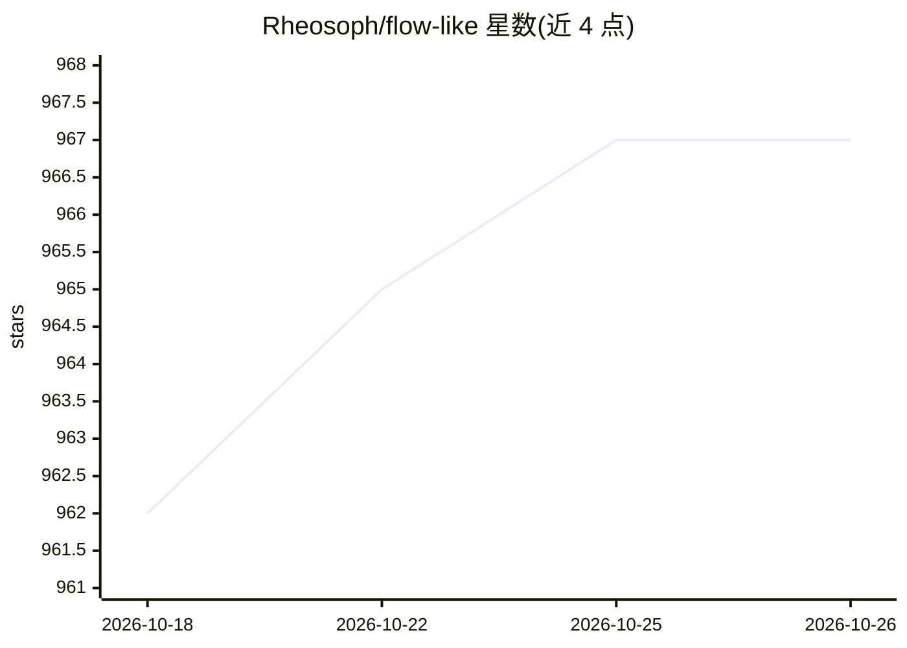

# Rheosoph/flow-like

⭐ 967 · Rust · NOASSERTION · 推送 2026-10-25 · [GitHub](https://github.com/Rheosoph/flow-like) · [官网](https://flow-like.com) · 组织维护

**面向开发者团队的自托管低代码应用/自动化/AI 开发平台**

Flow-Like 是一个可自托管的开發平台，用 1,900+ 内置类型化节点构建应用、自动化流程、数据处理与 AI 助手，覆盖 SQL、API、文档、桌面自动化、工业协议（OPC UA/Modbus/MQTT）与机器学习。架构为 Rust 执行引擎 + Tauri 桌面客户端（Studio）+ TypeScript/React 界面，支持可视化画布与 FlowScript 文本双向编辑同一工作流。AI 属于平台能力之一（可配置本地或托管模型的助手、FlowPilot 对话式编辑）。自托管路径为 Docker Compose 与 Kubernetes（Helm），源码许可为 BSL 1.1（source-available）。

## 筛选速览

| 维度 | 判定 | 备注 |
|---|---|---|
| AI 角色 | `ai-enhanced` | 去掉 AI 部分产品仍成立 |
| 许可风险 | `none` | NOASSERTION |
| 部署形态 | `self-host` | docker 或自建部署 |
| 模型依赖 | — | README 未给出锁定关系 |
| 硬件要求 | — | 无带数字的原话,不猜 |
| 安装摩擦 | `low` | 无编译、无系统依赖或容器化 |
| 成熟度 | `idea` | |

## 能力要点

- 1,900+ 内置类型化节点，覆盖数据库、API、文档、桌面自动化、工业协议、AI/ML
- Rust 执行引擎 + Tauri 桌面客户端，工作流可可视化或 FlowScript 文本编辑
- 自托管支持 Docker Compose（含 gVisor 沙箱隔离）与 Kubernetes Helm Chart
- 包系统支持自定义 Rust 节点、15 种语言的 WebAssembly 模板与界面组件

## 适用场景

- 搭建连接现有系统的内部运营控制台与数据工具
- 构建可调用工具与知识库的 AI 助手应用
- 通过文档提取、校验与人工审核界面处理业务单据

## 场景标签

`工作流自动化` `GUI 自动化` · 领域:效率与自动化

## 证据(README 行号)

> L8:  A self-hostable development platform for apps, automation, data, and AI.
> L109: |**An assistant that can act**|Retrieve knowledge, call tools, and return results through chat or an application u

## 星数曲线

2026-10-18 962 → 2026-10-26 967（+5）

---
*卡片 v1 · prompt 1.4 · 生成 2026-10-21 · 置信度 high · 依据 README sha `53f3417dc598` · [字段定义](../../DATASET.md)*
