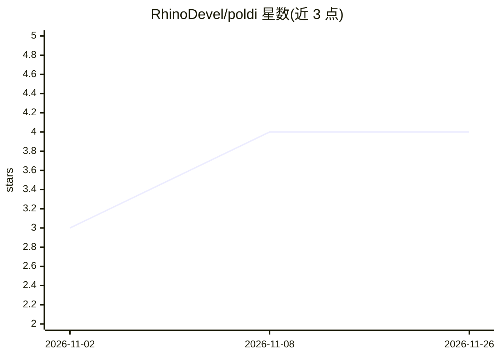

# RhinoDevel/poldi

⭐ 4 · C# · GPL-3.0 · 推送 2026-11-18 · [GitHub](https://github.com/RhinoDevel/poldi) · 个人维护

**消费级硬件上运行的私有离线语音 AI 助手**

Poldi 是部署在自有硬件上的本地 AI 助手，通过语音（免手持客户端或浏览器 web 客户端）或终端进行对话，服务端负责 STT/TTS。面向 GPU 资源有限的个人用户，围绕 12B/27B 级小模型与消费级硬件做优化：上下文满时自动总结腾出空间（"infinite chat"）、重启自动恢复会话、SQLite 存储全部聊天记录并抽取用户记忆语句按需注入。带模块机制（联网搜索、Wikipedia、聊天历史搜索，经分类器自动激活），TOML 文件配置，Linux 为主、服务端可在 Windows 编译运行。

## 筛选速览

| 维度 | 判定 | 备注 |
|---|---|---|
| AI 角色 | `ai-native` | 本体是模型或模型工具 |
| 许可风险 | `viral` | GPL-3.0 |
| 部署形态 | `None` |  |
| 模型依赖 | local-ok | 支持本地模型 |
| 硬件要求 | `gpu-8g` | |
| 安装摩擦 | `medium` | 含编译或系统依赖之一 |
| 成熟度 | — | 结构信号不足 |

## 能力要点

- wakeword 唤醒的免手持语音客户端与可手机访问的 web 客户端，支持中途打断
- 上下文满时自动摘要前半对话实现 infinite chat，重启自动恢复会话状态
- SQLite 存储聊天协议并抽取记忆语句自动注入，支持全历史话题搜索
- 模块机制（联网搜索/Wikipedia/历史搜索）由分类器自动激活

## 适用场景

- 在自有电脑上搭建不外发数据的私人语音助手
- 低显存 GPU 或纯 CPU 机器上运行本地大模型对话
- 让助手记住个人偏好并长期保存聊天记录
- 通过语音点播本地音乐库中的歌曲

## 场景标签

`AI 助手` `语音 Agent` · 领域:对话与助手

## 证据(README 行号)

> L6: Poldi is an artificial intelligence that runs on your own hardware.
> L49: - **Speech interface** with two options: Either use the
> L202: - For the chat mode (the only mode we will use initially), configure the LLM

## 星数曲线

2026-11-02 3 → 2026-11-26 4（+1）

---
*卡片 v1 · prompt 1.4 · 生成 2026-11-21 · 置信度 high · 依据 README sha `d366c82471e7` · [字段定义](../../DATASET.md)*
