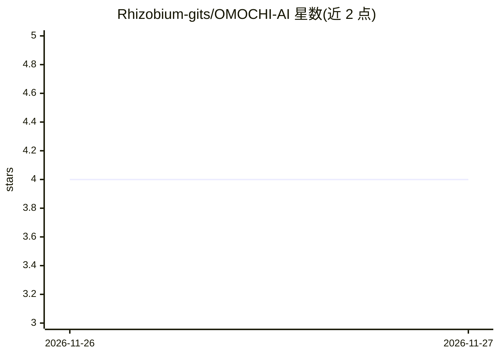

# Rhizobium-gits/OMOCHI-AI

⭐ 4 · Swift · MIT · 推送 2026-11-26 · [GitHub](https://github.com/Rhizobium-gits/OMOCHI-AI) · 个人维护

**在 Mac 桌面统一管理并组队多个 AI CLI 代理的应用**

面向 macOS 桌面用户的 AI 代理管理应用：以像素风年糕形象呈现各代理，⌘L 唤出并下达指令，代理底层运行 Claude Code、Codex CLI、Gemini CLI 等官方 CLI 并复用用户已有登录。代理可互相连线组队、跨 AI 分工、按序串接（串団子/鏡餅）、并行同一指令比较结果（餅まき），支持定时预约、PC 操作、日历/邮件连接器、菜单栏用量统计。以 .dmg 分发，需 macOS 14+，未经 Apple 公证需手动放行，不处理 API 密钥、按登录账号计费。

## 筛选速览

| 维度 | 判定 | 备注 |
|---|---|---|
| AI 角色 | `ai-ecosystem` | LLM/agent 周边工具 |
| 许可风险 | `permissive` | MIT |
| 部署形态 | `desktop` | 安装包/桌面程序 |
| 模型依赖 | locked-api |  |
| 硬件要求 | — | 无带数字的原话,不猜 |
| 安装摩擦 | `medium` | 含编译或系统依赖之一 |
| 成熟度 | — | 结构信号不足 |

## 能力要点

- 以年糕形态的桌面代理，支持拆分/合并/串接/镜饼等交互式组队操作
- 跨 AI 分工：Claude 代理可调度 ChatGPT、Gemini 的队友，复用各官方 CLI 登录
- 菜单栏显示 Claude/ChatGPT 用量配额，按 AI/模型/账号统计次数与 token
- 连接器可控制代理对日历、提醒事项、邮件的访问，写操作需逐次确认

## 适用场景

- 在一个界面里同时使用和管理 Claude Code、Codex、Gemini 多个代理
- 把一个任务拆给不同 AI 代理串行或并行分工完成
- 通过桌面代理执行屏幕查看、文件整理等 Mac 本地操作

## 场景标签

`编码 Agent` `多智能体` `GUI 自动化` · 领域:Agent 开发

## 证据(README 行号)

> L13:  いろいろな AI エージェントをデスクトップで一元管理し、エージェント同士をつないでチームとして動かせる macOS アプリです。
> L81: - 仲間はそれぞれの AI の公式の CLI を、あなたのログインのまま動かします。チャットのタイトルと返答の見出しに、その仲間の AI（ここでは ChatGPT（Codex））が出ます
> L91: - 次の AI の CLI のどれか 1 つ以上（使う AI とアカウント）。いちばん多くの機能が使えるのは Claude Code です。入っていなくても、アプリから許可して入れられます

## 星数曲线

2026-11-26 4 → 2026-11-27 4（+0）

---
*卡片 v1 · prompt 1.4 · 生成 2026-11-26 · 置信度 low · 依据 README sha `5eafe396cd73` · [字段定义](../../DATASET.md)*
