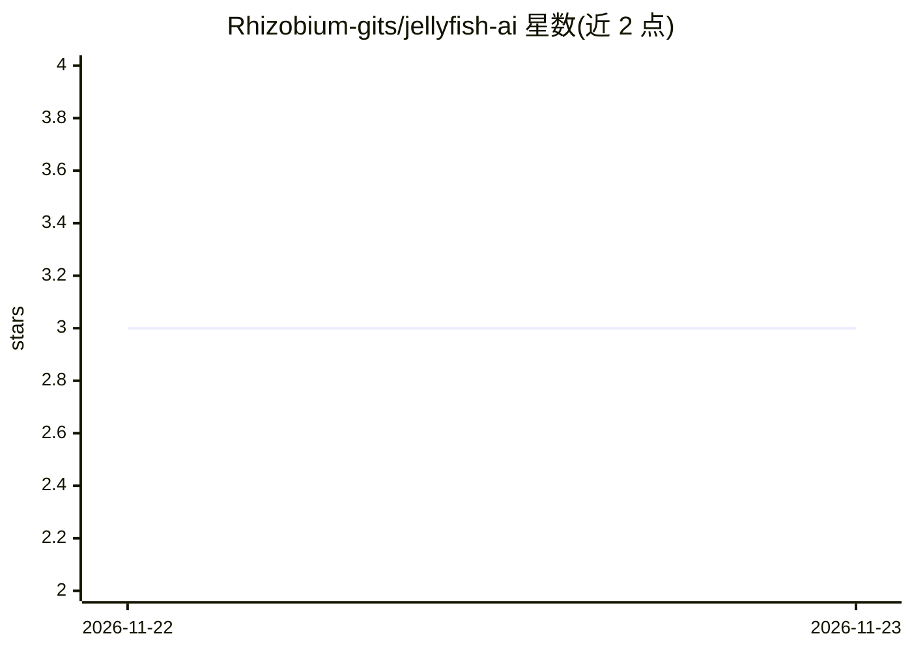

# Rhizobium-gits/jellyfish-ai

⭐ 3 · Swift · MIT · 推送 2026-11-22 · [GitHub](https://github.com/Rhizobium-gits/jellyfish-ai) · 个人维护 · 中文 README

**桌面像素水母即独立 AI 代理的 macOS 应用**

macOS 常驻应用，屏幕上每只像素水母是一个独立 AI 代理，底层运行 Claude Code、Codex CLI 或 Gemini CLI，并使用用户各自账号的登录态。⌘L 生成水母并下达指令，代理以动画显示思考中/作业中/完成/错误状态。支持跨 AI 团队分业（水母靠近连接，代理可生成不同 AI 的队友）、自律组织模式、聊天内表格/公式/Mermaid 图表渲染、语音输入、本地 OCR 错误监视、日历/邮件等连接器、菜单栏用量显示。以 .dmg/.zip 分发，未公证需手动放行，不处理 API 密钥。

## 筛选速览

| 维度 | 判定 | 备注 |
|---|---|---|
| AI 角色 | `ai-native` | 本体是模型或模型工具 |
| 许可风险 | `permissive` | MIT |
| 部署形态 | `desktop` | 安装包/桌面程序 |
| 模型依赖 | locked-api |  |
| 硬件要求 | — | 无带数字的原话,不猜 |
| 安装摩擦 | `medium` | 含编译或系统依赖之一 |
| 成熟度 | — | 结构信号不足 |

## 能力要点

- 每只水母对应一个独立代理，可分属 Claude/ChatGPT/Gemini，跨 AI 组队分业
- ⌘L 全局唤出代理，动画显示工作状态，会话可回到 Claude Code/终端续接
- 本地 OCR 错误监视（不上传、默认关闭）与日历/提醒/邮件连接器
- 菜单栏显示各账号订阅用量，不使用 API 密钥计费

## 适用场景

- 在桌面常驻多个 AI 代理并行处理指令
- 让不同 AI 的代理组队分业完成一个任务
- 用语音或屏幕截图向代理下达指令
- 查看 Claude/ChatGPT 订阅用量上限

## 场景标签

`多智能体` `编码 Agent` · 领域:Agent 开发

## 证据(README 行号)

> L13:  デスクトップ上にAIエージェントが常駐し、1 体ずつが独立した AI エージェント（Claude Code・Codex・Gemini）として動く macOS アプリです。
> L41: |**チャット**|ChatGPT・Claude・Gemini のアプリのように、**表・数式・図とグラフ・色分けしたコード** をそのまま表示。画像・PDF はサムネイル、Web ページは表紙とタイトル。🎙 Mac の音声入力、

## 星数曲线

2026-11-22 3 → 2026-11-23 3（+0）

---
*卡片 v1 · prompt 1.4 · 生成 2026-11-22 · 置信度 mid · 依据 README sha `ec6996bf504e` · [字段定义](../../DATASET.md)*
