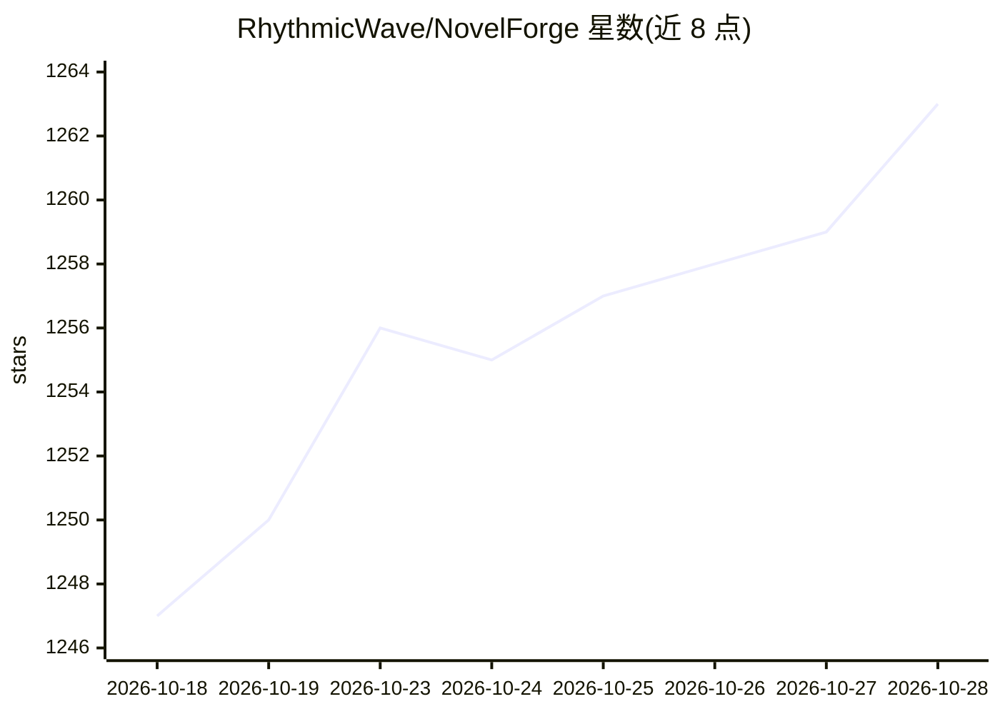

# RhythmicWave/NovelForge

⭐ 1,263 · Python · AGPL-3.0 · 推送 2026-09-23 · [GitHub](https://github.com/RhythmicWave/NovelForge) · 组织维护 · 中文 README

**面向长篇小说作者的卡片式 AI 辅助创作桌面应用**

Electron + FastAPI 架构的 AI 长篇小说创作工具：以模块化卡片组织设定，支持基于 JSON Schema 的结构化 AI 生成、字段粒度流式填充与反馈迭代；通过 @DSL 引用项目数据注入上下文，结合知识图谱（SQLite 默认，兼容 Neo4j）维护角色关系一致性。内置灵感助手 Agent、代码式工作流与 Workflow Agent、章节字数控制、审核流程和灵感工作台。需自备 LLM API 配置，推荐 Gemini 2.5 Pro 级别以上模型；提供源码运行与 Windows 便携发行版两种方式。

## 筛选速览

| 维度 | 判定 | 备注 |
|---|---|---|
| AI 角色 | `ai-native` | 本体是模型或模型工具 |
| 许可风险 | `dual` | AGPL-3.0 |
| 部署形态 | `desktop` | 安装包/桌面程序 |
| 模型依赖 | — | README 未给出锁定关系 |
| 硬件要求 | — | 无带数字的原话,不猜 |
| 安装摩擦 | `low` | 无编译、无系统依赖或容器化 |
| 成熟度 | `idea` | |

## 能力要点

- Schema 驱动的卡片创作，AI 生成按结构校验并支持字段粒度流式填充
- @DSL 上下文注入，可按标题/类型/过滤器引用项目任意数据
- 关系图谱支持 SQLite（默认）与 Neo4j 双存储
- 代码式工作流系统与自然语言工作流 Agent

## 适用场景

- 自顶向下按雪花创作法等流程创作数百万字级长篇
- 通过灵感助手跨卡片讨论设定并让 AI 直接修改卡片
- 将常用创作动作编排为可复用的自动化工作流

## 场景标签

`AI 写作` `工作流自动化` · 领域:效率与自动化

## 证据(README 行号)

> L18: **NovelForge** 是一款具备数百万字级长篇创作潜力的 AI 辅助写作工具。它不仅是编辑器，更是一套集世界观构建、结构化内容生成于一体的解决方案。
> L39: * **📚 Schema 驱动的卡片创作**
> L417: 1. **配置大语言模型 (LLM)**

## 星数曲线

2026-10-18 1,247 → 2026-10-28 1,263（+16）

---
*卡片 v1 · prompt 1.4 · 生成 2026-10-21 · 置信度 high · 依据 README sha `2fdf10b7ebfc` · [字段定义](../../DATASET.md)*
