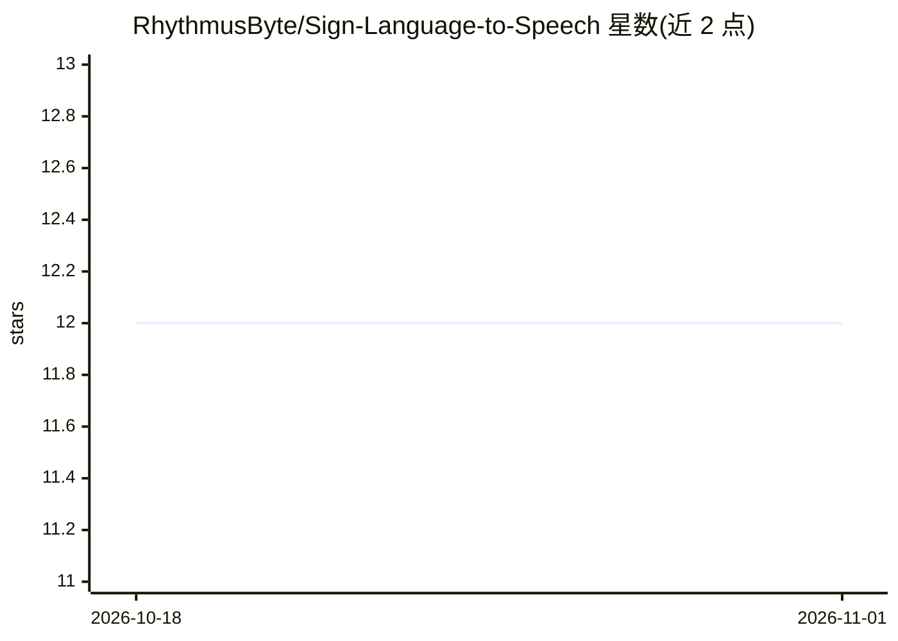

# RhythmusByte/Sign-Language-to-Speech

⭐ 12 · Python · BSD-3-Clause · 推送 2026-08-19 · [GitHub](https://github.com/RhythmusByte/Sign-Language-to-Speech) · 组织维护

**实时 ASL 手语识别系统，将手势转为文本与语音**

基于计算机视觉与深度学习的美式手语（ASL）实时识别系统：通过 OpenCV 与 cvzone 进行手部检测与跟踪，使用 TensorFlow/Keras 训练的 CNN 模型对手势分类，识别结果同时输出文本与语音（pyttsx3）。仓库包含 Application.py、预训练模型 trainedModel.h5 与 requirements.txt，面向无障碍与沟通场景。安装、架构与使用细节放置在 Project Wiki 中，README 未直接给出安装命令。

## 筛选速览

| 维度 | 判定 | 备注 |
|---|---|---|
| AI 角色 | `ai-native` | 本体是模型或模型工具 |
| 许可风险 | `permissive` | BSD-3-Clause |
| 部署形态 | `None` |  |
| 模型依赖 | — | README 未给出锁定关系 |
| 硬件要求 | — | 无带数字的原话,不猜 |
| 安装摩擦 | `low` | 无编译、无系统依赖或容器化 |
| 成熟度 | — | 结构信号不足 |

## 能力要点

- 实时手部检测与手势跟踪（OpenCV/cvzone）
- 基于 TensorFlow/Keras 的 CNN 手势分类
- 识别结果同时输出文本与语音（pyttsx3）
- 仓库附带预训练模型 trainedModel.h5

## 适用场景

- 我需要将 ASL 手势实时转成文字和语音与他人沟通
- 我想在演示或教学场景展示手语识别系统的效果
- 我想基于预训练模型与代码继续训练自己的手势分类器

## 场景标签

`目标检测` · 领域:感知与多模态

## 证据(README 行号)

> L9: **Sign Language to Speech Conversion** is a real-time **American Sign Language (ASL) recognition system** powered by
> L15: - 🧠 **CNN-based** classification using TensorFlow/Keras

## 星数曲线

2026-10-18 12 → 2026-11-01 12（+0）

---
*卡片 v1 · prompt 1.4 · 生成 2026-11-01 · 置信度 high · 依据 README sha `a0d859136cd3` · [字段定义](../../DATASET.md)*
