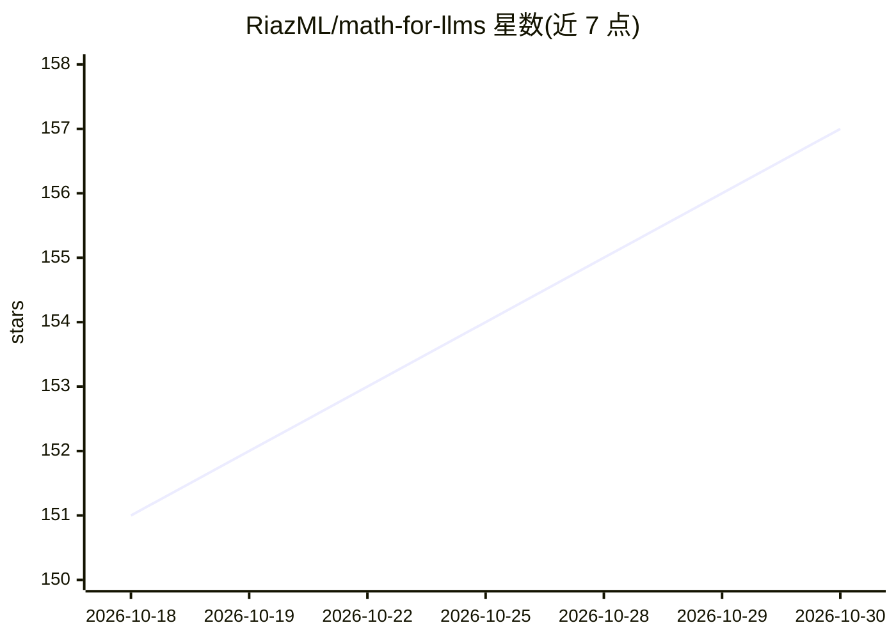

# RiazML/math-for-llms

⭐ 157 · Jupyter Notebook · MIT · 推送 2026-06-11 · [GitHub](https://github.com/RiazML/math-for-llms) · 个人维护

**面向 AI/ML/LLM 学习者的数学课程库，覆盖 25 个领域**

开源数学课程仓库，为学习 AI/机器学习/大语言模型的人员提供从高中基础到研究前沿的结构化数学内容：25 个数学领域按 8 个阶段组织，涵盖线性代数、概率统计、优化、信息论、LLM 数学（注意力、scaling laws）、对齐与安全（RLHF/DPO）及研究前沿等。每个主题遵循 notes.md → theory.ipynb → exercises.ipynb 三步学习流，提供含可视化的交互式 Jupyter notebook，并将每个概念关联到具体 ML 应用。MIT 许可，通过 git clone 获取。

## 筛选速览

| 维度 | 判定 | 备注 |
|---|---|---|
| AI 角色 | `ai-knowledge` | 知识聚合/清单类 |
| 许可风险 | `permissive` | MIT |
| 部署形态 | `None` |  |
| 模型依赖 | — | README 未给出锁定关系 |
| 硬件要求 | — | 无带数字的原话,不猜 |
| 安装摩擦 | `low` | 无编译、无系统依赖或容器化 |
| 成熟度 | — | 结构信号不足 |

## 能力要点

- 25 个数学领域按 8 阶段组织，从基础到研究前沿
- 每主题 notes → theory → exercises 三步学习流
- 交互式 Jupyter notebook 含可视化
- 每个数学概念标注与 ML 应用（如反向传播、KL 散度、RLHF）的关联

## 适用场景

- 系统补齐阅读 AI 论文所需的数学基础
- 按阶段路线图自学从基础到 LLM/对齐相关的数学
- 查找特定 ML 概念（如 attention、scaling laws）背后的数学原理

## 场景标签

`教程课程` · 领域:学习与行业

## 证据(README 行号)

> L12: **A structured, open-source curriculum covering 25 domains of mathematics essential for AI, Machine Learning, and L
> L26: - **Structured path** from high school math to research-level topics
> L53: The curriculum covers **25 domains** organized in **8 phases**. Each phase builds on the previous one. Topics marke

## 星数曲线

2026-10-18 151 → 2026-10-30 157（+6）

---
*卡片 v1 · prompt 1.4 · 生成 2026-10-22 · 置信度 high · 依据 README sha `9f6de5a55c70` · [字段定义](../../DATASET.md)*
