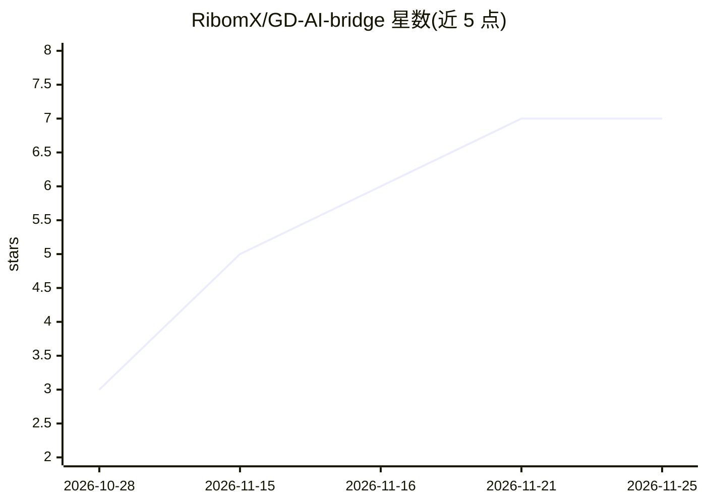

# RibomX/GD-AI-bridge

⭐ 7 · C++ · MIT · 推送 2026-10-19 · [GitHub](https://github.com/RibomX/GD-AI-bridge) · 个人维护

**让 AI 经 MCP/HTTP 在 Geometry Dash 编辑器中读写关卡的桥接 mod**

Geometry Dash 的 Geode mod，在本地运行 JSON API（127.0.0.1:7312），通过 MCP 服务器或 HTTP 让任意支持 function-calling 的 AI 读写编辑器内容：AI 可放置/填充/连线/复制/移动物体、读取 ASCII 地图与压缩物体列表、用预设输入试玩关卡并返回死亡位置，还可离线直接编辑存档文件或导出 .gdlvl 文件。每次改动都是普通撤销步骤，离线改动前自动备份存档。仅支持 GD 2.2081（mod 模式）与 2.209+（无 mod 离线模式），仅 Windows，且未随 Geode 官方索引分发、需从 GitHub release 下载。

## 筛选速览

| 维度 | 判定 | 备注 |
|---|---|---|
| AI 角色 | `ai-enhanced` | 去掉 AI 部分产品仍成立 |
| 许可风险 | `permissive` | MIT |
| 部署形态 | `library` | 以包/库形式分发 |
| 模型依赖 | local-ok | 支持本地模型 |
| 硬件要求 | — | 无带数字的原话,不猜 |
| 安装摩擦 | `medium` | 含编译或系统依赖之一 |
| 成熟度 | — | 结构信号不足 |

## 能力要点

- MCP 服务器 + 本地 JSON API 两种接入方式，非 MCP 客户端也能用 HTTP 调用
- AI 试玩工具：以计划输入运行关卡（最高 4x 速度），返回死亡位置与玩家路径
- 离线模式：游戏关闭时直接读写本地存档并自动备份，可导出 .gdlvl 文件
- 批量构建工具（填充/画线/复制/移动）与实测物理数据降低 AI 逐块放置成本

## 适用场景

- 让 Claude Code/Cursor 等 AI 客户端在编辑器里代建并试玩关卡
- 游戏关闭时让 AI 直接在存档中新建或修改关卡
- 自己写的脚本通过 HTTP API 批量操作关卡物体

## 场景标签

 · 领域:游戏/AI 工具集成

## 证据(README 行号)

> L3: A Geode mod that lets **any AI** read and edit levels in the Geometry Dash editor.
> L83: Install Node.js (the LTS version), then pick your AI below.
> L182: The mod runs a small JSON API on `127.0.0.1:7312`, so anything that can make HTTP requests can use it, not just MC

## 星数曲线

2026-10-28 3 → 2026-11-25 7（+4）

---
*卡片 v1 · prompt 1.4 · 生成 2026-11-20 · 置信度 high · 依据 README sha `ea004e67ddfb` · [字段定义](../../DATASET.md)*
