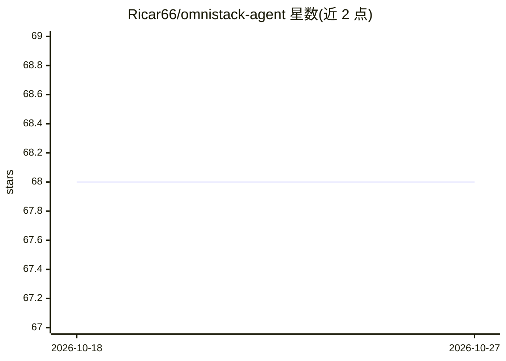

# Ricar66/omnistack-agent

⭐ 68 · JavaScript · MIT · 推送 2026-10-02 · [GitHub](https://github.com/Ricar66/omnistack-agent) · 个人维护

**面向各 AI 编程助手的全栈工程技能包：一套源生成多平台适配**

为 ChatGPT、Claude Code、Copilot、Gemini、Cursor、Windsurf 等 AI 助手提供可安装的工程技能与参考知识：由单一源码（core/workflows/knowledge）生成十二种工程角色的指令与适配文件，包含调试、代码评审、安全评审等任务技能。通过 Node 安装脚本按平台预览并安装技能包，无 npm 依赖；也可手动粘贴 Markdown 适配器。工具、权限与模型选择由宿主平台决定，自身不运行模型。提供三个维护者编写的可复现演示与检查脚本。

## 筛选速览

| 维度 | 判定 | 备注 |
|---|---|---|
| AI 角色 | `ai-ecosystem` | LLM/agent 周边工具 |
| 许可风险 | `permissive` | MIT |
| 部署形态 | `library` | 以包/库形式分发 |
| 模型依赖 | locked-api |  |
| 硬件要求 | — | 无带数字的原话,不猜 |
| 安装摩擦 | `low` | 无编译、无系统依赖或容器化 |
| 成熟度 | — | 结构信号不足 |

## 能力要点

- 一套源码生成 7 类宿主平台的适配器（ChatGPT/Claude/Copilot/Gemini/Cursor/Windsurf/API）
- 十二种工程角色与调试、代码评审、安全评审等任务技能包
- Node 安装脚本支持 dry-run 预览、冲突拒绝与无操作幂等安装
- 零 npm 依赖，生成文件已提交，无需构建即可使用

## 适用场景

- 给 Claude Code / Cursor / Copilot 等助手安装调试与评审技能
- 为不同 AI 编程平台统一提供一套工程参考知识
- 用可复现演示与检查脚本验证技能安装效果

## 场景标签

`提示工程` · 领域:Agent 开发

## 证据(README 行号)

> L7: **omnistack-agent** helps an AI assistant debug code, review changes, implement features, and explain engineering de
> L9: One assistant can use twelve engineering roles. Tools, permissions, model selection, and delegation come from your h
> L58: |Platform|Adapter|Use|

## 星数曲线

2026-10-18 68 → 2026-10-27 68（+0）

---
*卡片 v1 · prompt 1.4 · 生成 2026-10-24 · 置信度 high · 依据 README sha `e575b074a00e` · [字段定义](../../DATASET.md)*
