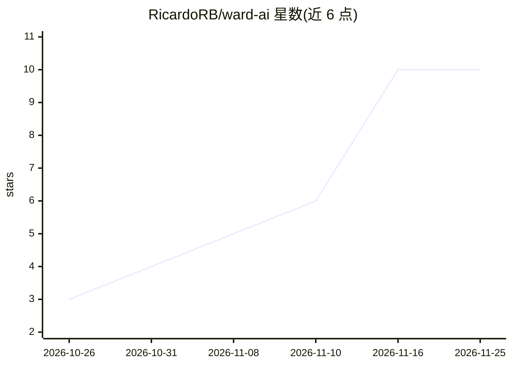

# RicardoRB/ward-ai

⭐ 10 · Java · Apache-2.0 · 推送 2026-11-24 · [GitHub](https://github.com/RicardoRB/ward-ai) · [官网](https://ricardorb.github.io/ward-ai/) · 个人维护

**给 AI 编程代理加质量闸门：检查每次编辑并让代理自行修复**

以 CLI 形式运行的质量门禁工具：规则写入仓库内的 ward.toml，按 Edit/Commit/Push/CI 四层 profile 分层执行测试、覆盖率、lint、格式、架构、安全、许可证、OpenAPI 等检查；每次代理编辑后运行快速检查并将失败结果回传给代理修复。支持 Java/Kotlin、TS/JS、Python、Swift 与 Android 项目；内置三个 agent 技能（init/tune/fix）协助配置。当前为 alpha，仅接收最新版本修复。

## 筛选速览

| 维度 | 判定 | 备注 |
|---|---|---|
| AI 角色 | `ai-ecosystem` | LLM/agent 周边工具 |
| 许可风险 | `permissive` | Apache-2.0 |
| 部署形态 | `library` | 以包/库形式分发 |
| 模型依赖 | — | README 未给出锁定关系 |
| 硬件要求 | — | 无带数字的原话,不猜 |
| 安装摩擦 | `high` | 编译与系统依赖俱全 |
| 成熟度 | `idea` | |

## 能力要点

- 四层质量闸门：Edit、Commit、Push、CI 各层递进加严
- 每次编辑后把失败结果交回代理自动修复
- 内置 lint、格式、架构、secrets、漏洞匹配、SBOM/许可证检查，多数检查无需额外安装工具
- 提供 ward-init/ward-tune/ward-fix 三个 agent 技能与多代理集成

## 适用场景

- 团队统一 AI 编码代理需遵守的代码规则并入库共享
- 在 CI 流水线中运行最外层质量与安全门禁
- 让代理按项目规则自动修复不合规代码

## 场景标签

`代码审查` · 领域:编码与开发

## 证据(README 行号)

> L5: **The quality gate for AI coding agents.**
> L74: Ward checks your code in four layers. Each layer is a **profile** in `ward.toml`. Inner
> L200: **Coding agents:** Claude Code, OpenCode, Codex, Cursor, GitHub Copilot CLI, Gemini CLI, Windsurf,

## 星数曲线

2026-10-26 3 → 2026-11-25 10（+7）

---
*卡片 v1 · prompt 1.4 · 生成 2026-11-20 · 置信度 mid · 依据 README sha `e0bf0408d87f` · [字段定义](../../DATASET.md)*
