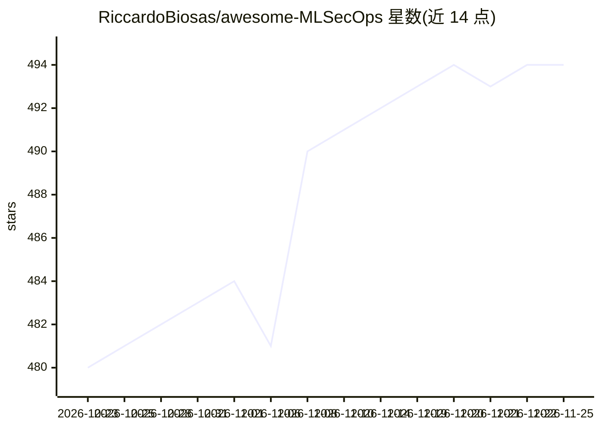

# RiccardoBiosas/awesome-MLSecOps

⭐ 494 · Astro · MIT · 推送 2026-11-23 · [GitHub](https://github.com/RiccardoBiosas/awesome-MLSecOps) · [官网](https://awesomemlsecops.com/) · 个人维护

**面向安全工程师与红队的 MLSecOps 开源工具与资源清单**

按机器学习安全运营（MLSecOps）主题组织的策展式目录：收录模型与工件安全、对抗样本测试、具身 AI 安全、LLM 红队、AI Agent 安全、隐私计算、供应链安全、模型评估等类别的开源工具与论文代码，每条附一句话功能描述。维护者同时运营 The MLSecOps Hacker 新闻 newsletter，新文章首发于此。清单声明部分条目为概念验证，提示使用前自行评估维护状态、许可与部署适用性。

## 筛选速览

| 维度 | 判定 | 备注 |
|---|---|---|
| AI 角色 | `ai-knowledge` | 知识聚合/清单类 |
| 许可风险 | `permissive` | MIT |
| 部署形态 | `None` |  |
| 模型依赖 | — | README 未给出锁定关系 |
| 硬件要求 | — | 无带数字的原话,不猜 |
| 安装摩擦 | `low` | 无编译、无系统依赖或容器化 |
| 成熟度 | — | 结构信号不足 |

## 能力要点

- 按 9+ 个类别组织：模型序列化攻击、对抗测试、LLM 红队、Agent 安全、供应链安全等
- 覆盖 Rogue Agents/Agentic Misalignment 类工具，映射 OWASP Agentic Top 10
- 包含具身 AI 与机器人 VLA 模型的对抗测试工具小节
- 维护者配套发布 The MLSecOps Hacker newsletter（RSS/存档）

## 适用场景

- 为 ML 系统选型安全测试与防护的开源工具
- AI 红队寻找 prompt 注入与越狱测试工具
- 为模型工件做 SBOM/签名与供应链防护选型

## 场景标签

`精选清单` `网络安全` · 领域:学习与行业

## 证据(README 行号)

> L9: This curated catalog helps security engineers, ML practitioners, developers, and AI red teams discover open-source M
> L38: Open-source MLSecOps tools help practitioners test, monitor, and protect machine learning models, data, pipelines, 

## 星数曲线

2026-10-23 480 → 2026-11-25 494（+14）

---
*卡片 v1 · prompt 1.4 · 生成 2026-11-25 · 置信度 high · 依据 README sha `6f4b4874dd5c` · [字段定义](../../DATASET.md)*
