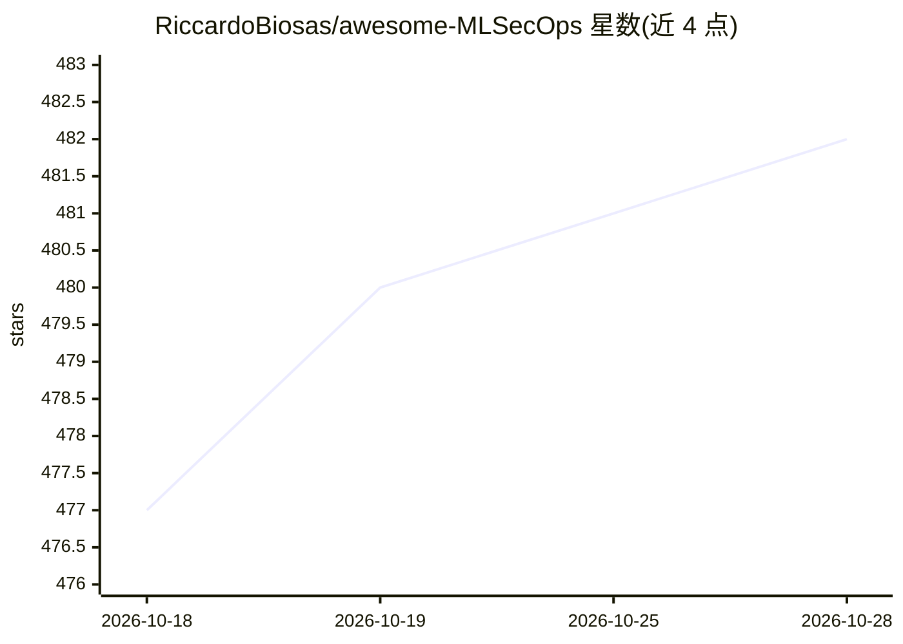

# RiccardoBiosas/awesome-MLSecOps

⭐ 482 · Astro · MIT · 推送 2026-10-27 · [GitHub](https://github.com/RiccardoBiosas/awesome-MLSecOps) · [官网](https://awesomemlsecops.com/) · 个人维护

**面向安全工程师的 MLSecOps 开源工具与研究策展清单**

由 The MLSecOps Hacker 通讯作者维护的策展目录，收录覆盖机器学习全生命周期的安全资源：模型与工件安全、对抗机器学习测试、具身智能与机器人安全、LLM 红队、AI Agent 安全、失控 Agent 治理、隐私保护机器学习、AI 供应链安全及模型评测监控等类别的工具、研究实现与 CTF 练习。面向安全工程师、ML 从业者与 AI 红队成员，用于发现相关开源工具与学习材料，不提供安装命令，条目维护状态需自行评估。

## 筛选速览

| 维度 | 判定 | 备注 |
|---|---|---|
| AI 角色 | `ai-knowledge` | 知识聚合/清单类 |
| 许可风险 | `permissive` | MIT |
| 部署形态 | `None` |  |
| 模型依赖 | — | README 未给出锁定关系 |
| 硬件要求 | — | 无带数字的原话,不猜 |
| 安装摩擦 | `low` | 无编译、无系统依赖或容器化 |
| 成熟度 | — | 结构信号不足 |

## 能力要点

- 按模型安全、对抗测试、LLM 红队、Agent 安全、供应链等 10+ 类别组织条目
- 收录具身智能/机器人 VLA 模型对抗攻击研究实现
- 包含 OWASP Agentic Top 10 风险映射的工具与治理框架
- 附对抗 ML CTF 与提示注入练习场等学习资源

## 适用场景

- 为 ML/AI 系统挑选安全测试与防护工具
- AI 红队寻找 LLM 与 Agent 攻击测试框架
- 了解对抗机器学习与 Agent 安全研究进展

## 场景标签

`网络安全` `精选清单` · 领域:学习与行业

## 证据(README 行号)

> L7: **MLSecOps (Machine Learning Security Operations)** is the practice of integrating security throughout the machine l
> L9: This curated catalog helps security engineers, ML practitioners, developers, and AI red teams discover open-source M

## 星数曲线

2026-10-18 477 → 2026-10-28 482（+5）

---
*卡片 v1 · prompt 1.4 · 生成 2026-10-21 · 置信度 high · 依据 README sha `95111b7590b9` · [字段定义](../../DATASET.md)*
