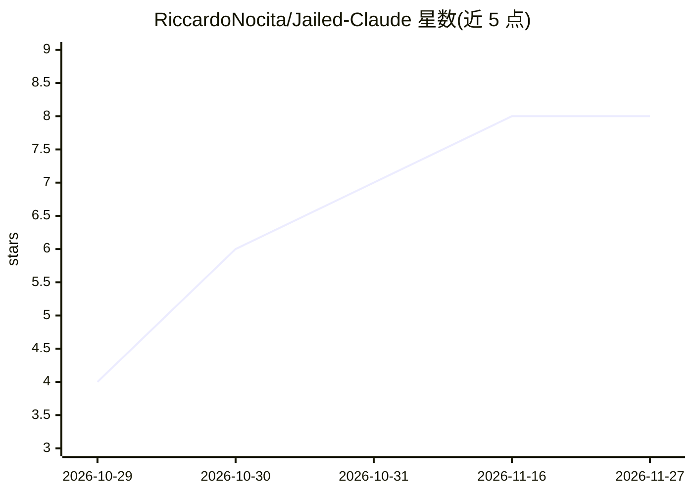

# RiccardoNocita/Jailed-Claude

⭐ 8 · Shell · MIT · 推送 2026-11-12 · [GitHub](https://github.com/RiccardoNocita/Jailed-Claude) · 个人维护

**把 Claude Code CLI 装进 Docker 沙箱运行的隔离包装器**

围绕官方 Claude Code CLI 的薄包装，不修改其行为，只在外面加一层控制与隔离：每次会话在一次性 Docker 容器中运行，仅挂载工作目录与 Claude 历史，隐藏指定路径，容器丢弃全部 capabilities 并以宿主 UID/GID 运行。支持 conf 文件切换 LLM 提供方/端点/模型；--isolated 在 DNS 层屏蔽上游域名，--strict 用 nftables sidecar 在 L3 只放行单一端点。需要 Docker ≥20.10，一行脚本安装。

## 筛选速览

| 维度 | 判定 | 备注 |
|---|---|---|
| AI 角色 | `ai-ecosystem` | LLM/agent 周边工具 |
| 许可风险 | `permissive` | MIT |
| 部署形态 | `self-host` | docker 或自建部署 |
| 模型依赖 | local-ok | 支持本地模型 |
| 硬件要求 | — | 无带数字的原话,不猜 |
| 安装摩擦 | `low` | 无编译、无系统依赖或容器化 |
| 成熟度 | — | 结构信号不足 |

## 能力要点

- 一次性 Docker 容器沙箱，只暴露工作目录与 ~/.claude
- conf/*.conf 提供方配置文件，一键切换端点/凭证/模型
- --strict 模式用 nftables sidecar 把出站流量钉死到单一端点
- 隐藏路径用只读空文件遮蔽，源码可不出本机

## 适用场景

- 在沙箱里运行 Claude Code，限制其对文件系统和网络的访问
- 让源代码不出本机地使用 Claude Code
- 通过本地网关端点替换上游提供方

## 场景标签

 · 领域:开发者工具/安全隔离

## 证据(README 行号)

> L36: `jailed-claude` is a thin **wrapper** around the official Claude Code CLI. It does **not** modify, patch, rebrand, 
> L38: - **Sandboxing** — every session runs in a throwaway Docker container that can only see the folder you're working i
> L47: - 🔌 Pluggable LLM-provider profiles via `conf/*.conf` (endpoint + auth + models)

## 星数曲线

2026-10-29 4 → 2026-11-27 8（+4）

---
*卡片 v1 · prompt 1.4 · 生成 2026-11-20 · 置信度 high · 依据 README sha `dcdaefd571b6` · [字段定义](../../DATASET.md)*
