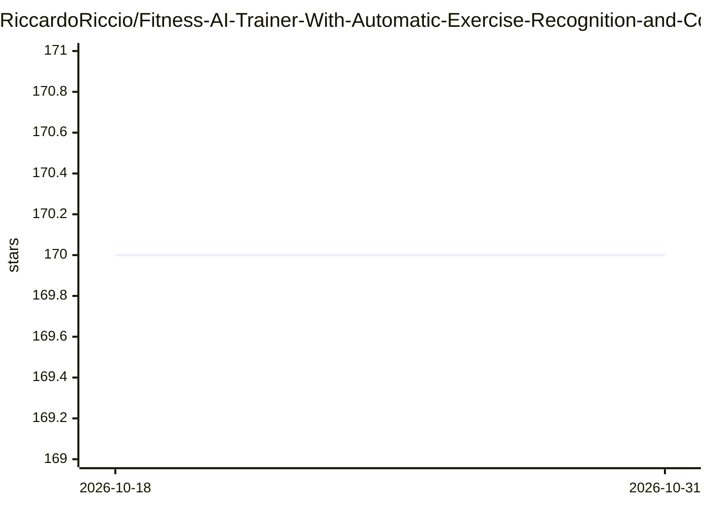

# RiccardoRiccio/Fitness-AI-Trainer-With-Automatic-Exercise-Recognition-and-Counting

⭐ 170 · Python · 推送 2026-02-28 · [GitHub](https://github.com/RiccardoRiccio/Fitness-AI-Trainer-With-Automatic-Exercise-Recognition-and-Counting) · 个人维护

**基于姿态估计与 BiLSTM 的实时健身动作识别与计数 Web 应用**

Streamlit Web 应用：通过 MediaPipe 提取人体关键点，用 LSTM/BiLSTM 模型实时识别运动动作并计数，支持视频上传分析、摄像头实时模式与自动分类计数；另含基于 OpenAI GPT-3.5-turbo 与 LangChain 的健身问答聊天机器人。当前仓库内置的是仅用角度与归一化距离训练的 BiLSTM Invariant 模型，性能最佳的混合坐标模型需自行用 train_bidirectionallstm.py 训练；教学视频仅含 shoulder_press_form.mp4。论文发表于 arXiv:2411.11548。

## 筛选速览

| 维度 | 判定 | 备注 |
|---|---|---|
| AI 角色 | `ai-native` | 本体是模型或模型工具 |
| 许可风险 | `none` | — |
| 部署形态 | `library` | 以包/库形式分发 |
| 模型依赖 | — | README 未给出锁定关系 |
| 硬件要求 | — | 无带数字的原话,不猜 |
| 安装摩擦 | `low` | 无编译、无系统依赖或容器化 |
| 成熟度 | — | 结构信号不足 |

## 能力要点

- MediaPipe 姿态估计提取关键点，LSTM/BiLSTM 实时动作分类
- 视频上传与摄像头两种模式的动作计数，另有自动分类计数模式
- GPT-3.5-turbo + LangChain ConversationChain 健身问答聊天机器人
- 配套 arXiv 论文与 Kaggle/Hugging Face 数据集

## 适用场景

- 居家健身时用摄像头实时统计动作次数
- 上传训练视频进行重复次数分析
- 向内置聊天机器人咨询健身问题

## 场景标签

`聊天机器人` `图像视频处理` · 领域:对话与助手

## 证据(README 行号)

> L3: This project is an AI-powered application that leverages Computer Vision, Pose Estimation, and Machine Learning to a
> L82: 3. **Auto Classify Mode**: Automatically identifies exercises in real-time and counts repetitions accordingly.
> L112: - **Pose Estimation**: Utilizes MediaPipe to extract key body landmarks and monitor movement.

## 星数曲线

2026-10-18 170 → 2026-10-31 170（+0）

---
*卡片 v1 · prompt 1.4 · 生成 2026-10-22 · 置信度 mid · 依据 README sha `69f8d6fd175a` · [字段定义](../../DATASET.md)*
