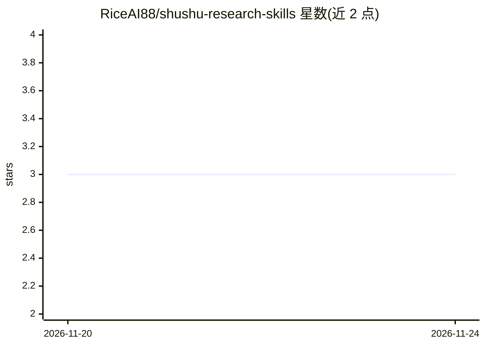

# RiceAI88/shushu-research-skills

⭐ 3 · JavaScript · MIT · 推送 2026-11-23 · [GitHub](https://github.com/RiceAI88/shushu-research-skills) · [官网](https://riceai985.cc/) · 个人维护 · 中文 README

**面向大学生的科研 Agent Skills 按专业与任务导航站**

由 RiceAI88 维护的科研 Skills 聚合与排行榜网站：通过 GitHub API 与热门搜索发现候选，核验 README 后收录含 SKILL.md 文件证据的项目，按学科门类、专业与科研任务（文献检索、论文写作、绘图、实验复现、数据分析等）组织，提供平台筛选、安装入口、依赖与维护信息、收藏对比、数据洞察及 RSS/JSON/CSV 订阅，每日定时更新排名。收录门槛为 Stars≥30，文档核对不等于安装实测；基于 kael-odin/awesome-academic-research-skills 改版，保留 MIT 许可。

## 筛选速览

| 维度 | 判定 | 备注 |
|---|---|---|
| AI 角色 | `ai-knowledge` | 知识聚合/清单类 |
| 许可风险 | `permissive` | MIT |
| 部署形态 | `None` |  |
| 模型依赖 | — | README 未给出锁定关系 |
| 硬件要求 | — | 无带数字的原话,不猜 |
| 安装摩擦 | `low` | 无编译、无系统依赖或容器化 |
| 成熟度 | — | 结构信号不足 |

## 能力要点

- 按专业（理/工/医/农/经管/法文等）与科研任务双维度筛选 Skills
- 收录 348 个 Skills 与 206 个科研相关项目，按 Stars 榜单展示
- 默认仅收录有 SKILL.md 文件证据的项目，采集核验机制公开
- 提供专业路径、收藏对比、数据洞察与 RSS/月报/JSON/CSV 订阅

## 适用场景

- 按学科专业找到适合自己科研任务的 Agent Skills
- 对比多个 Skills 的安装方式、依赖和维护状态
- 跟踪科研 Skills 生态的新增与增长趋势

## 场景标签

`精选清单` `科研工具` · 领域:学习与行业

## 证据(README 行号)

> L5: **科研鼠鼠 · Skills 导航站**（`shushu-research-skills`）由 RiceAI88 整理维护，汇集 GitHub 上用于文献检索、论文阅读、写作、绘图、数据分析和科研计算的 Agent Skills。
> L45: 一个项目可以用于多个场景。网站默认只展示有 `SKILL.md` 文件证据的 Skills；需要科研工具或资料时，可在“收录范围”中打开“含科研相关项目”。
> L53: - **找到适合的平台**：搜索关键词，按 Claude Code、Codex、Antigravity、Cursor、MCP 等适用平台筛选；不同项目支持的平台不同，安装前以官方文档为准。

## 星数曲线

2026-11-20 3 → 2026-11-24 3（+0）

---
*卡片 v1 · prompt 1.4 · 生成 2026-11-22 · 置信度 high · 依据 README sha `f0c2b50963d0` · [字段定义](../../DATASET.md)*
