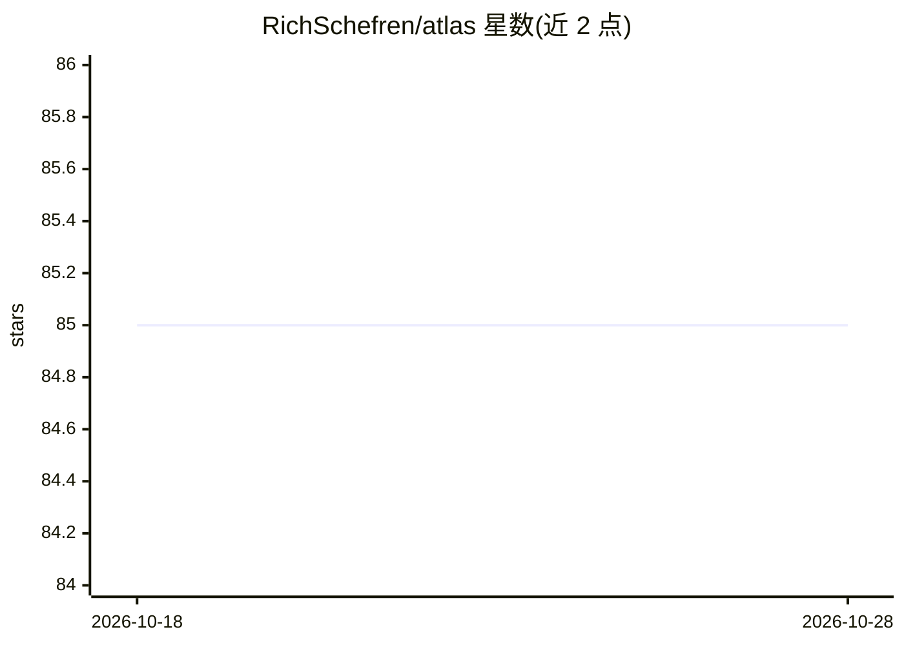

# RichSchefren/atlas

⭐ 85 · Python · Apache-2.0 · 推送 2026-10-01 · [GitHub](https://github.com/RichSchefren/atlas) · [官网](https://livememory.dev) · 个人维护

**本地优先的认知记忆后端：事实变化时自动重估下游信念**

在属性图上实现 AGM 合规信念修正的认知记忆系统，通过 Ripple 传播引擎在事实变化时重新计算所有依赖该事实的下游信念，并以置信度更新、矛盾检测和 Obsidian 裁决队列呈现结果。使用 Neo4j + SQLite，提供 MCP/HTTP 接口以及 Hermes、OpenClaw、GBrain 原生适配包，供 agent 构建者、Obsidian 重度用户、本地优先 AI 构建者和信念修正研究者使用。自述为 alpha，非结构化文本摄取质量仍在迭代，类型化本体对部分用户构成使用门槛。

## 筛选速览

| 维度 | 判定 | 备注 |
|---|---|---|
| AI 角色 | `ai-ecosystem` | LLM/agent 周边工具 |
| 许可风险 | `permissive` | Apache-2.0 |
| 部署形态 | `self-host` | docker 或自建部署 |
| 模型依赖 | — | README 未给出锁定关系 |
| 硬件要求 | — | 无带数字的原话,不猜 |
| 安装摩擦 | `low` | 无编译、无系统依赖或容器化 |
| 成熟度 | `idea` | |

## 能力要点

- Ripple 传播引擎：上游事实变化自动重估下游信念
- AGM 合规（49/49 场景，含 Hansson Relevance/Core-Retainment）
- SHA-256 哈希链审计账本与 Obsidian 裁决队列
- MCP/HTTP 接口 + Hermes/OpenClaw/GBrain 原生适配包

## 适用场景

- 为 agent 运行时接入带信念修正语义的记忆后端
- 价格、人员、期限等事实变化后自动发现受影响的下游决策
- 对会议转录、屏幕捕获等个人数据做多流交叉矛盾检查

## 场景标签

`知识图谱` `Agent 记忆` · 领域:Agent 开发

## 证据(README 行号)

> L70: - **Not yet a Letta replacement.** Atlas does not run agent loops. It plugs into agent runtimes as a memory backend
> L115: - **Agent / tool builders** who need a memory backend with belief-revision semantics (MCP/HTTP surfaces plus nativ

## 星数曲线

2026-10-18 85 → 2026-10-28 85（+0）

---
*卡片 v1 · prompt 1.4 · 生成 2026-10-24 · 置信度 mid · 依据 README sha `e370bea26bf3` · [字段定义](../../DATASET.md)*
