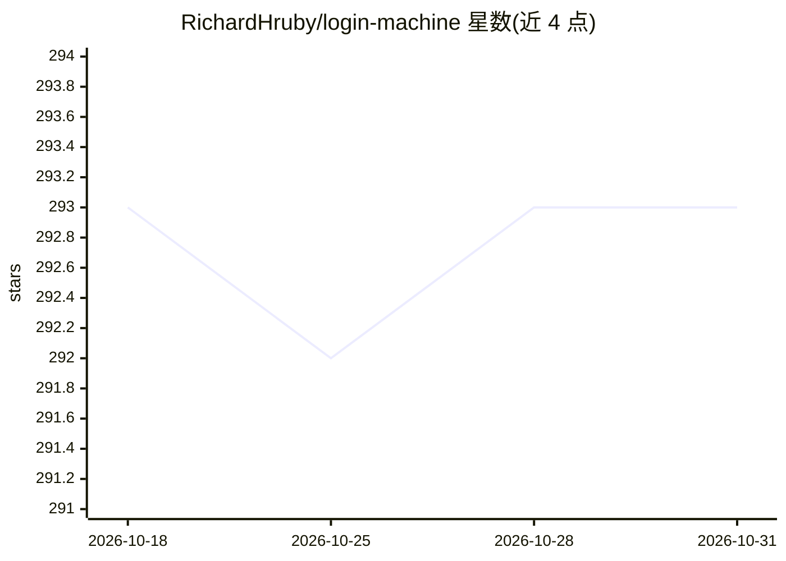

# RichardHruby/login-machine

⭐ 293 · TypeScript · MIT · 推送 2026-02-19 · [GitHub](https://github.com/RichardHruby/login-machine) · [官网](https://login-machine.vercel.app) · 组织维护

**通用网站登录的浏览器 Agent：LLM 分类页面，凭据不进模型**

由 Anon 维护的浏览器自动化 Agent：以单一循环处理任意网站的登录流程（多步凭据、SSO 选择、MFA、魔法链接等）。机制上由 Claude 视觉模型将页面分类为六种屏幕类型并生成 Playwright 定位器，定位器先对实时 DOM 校验、失败带错误上下文重试（最多 3 次）；凭据不经模型，直接由用户输入流向浏览器 DOM。页面 HTML 被精简为表单相关标签并穿透 Shadow DOM。技术栈为 Next.js + Vercel AI SDK + BrowserBase，需 Anthropic 与 BrowserBase API key。

## 筛选速览

| 维度 | 判定 | 备注 |
|---|---|---|
| AI 角色 | `ai-native` | 本体是模型或模型工具 |
| 许可风险 | `permissive` | MIT |
| 部署形态 | `library` | 以包/库形式分发 |
| 模型依赖 | locked-api |  |
| 硬件要求 | — | 无带数字的原话,不猜 |
| 安装摩擦 | `low` | 无编译、无系统依赖或容器化 |
| 成熟度 | — | 结构信号不足 |

## 能力要点

- 单一 Agent 循环处理任意登录流程，替代逐站脚本
- 凭据隔离：LLM 只返回结构化字段描述，不接触用户输入
- LLM 生成定位器前经实时 DOM 校验，失败带错误历史重试
- 六种屏幕类型分类，各配 Zod schema

## 适用场景

- 为浏览器 Agent 通用化地完成各网站登录
- 处理 SSO 选择器、MFA 提示、魔法链接等多步登录流程
- 凭据敏感场景下让 LLM 操作登录页但不接触密码

## 场景标签

`浏览器自动化` · 领域:效率与自动化

## 证据(README 行号)

> L57:     B --> C["LLM Classifies Screen Type"]
> L63: **Credential isolation.** The LLM analyzes the page and returns structured data describing what fields exist and th

## 星数曲线

2026-10-18 293 → 2026-10-31 293（+0）

---
*卡片 v1 · prompt 1.4 · 生成 2026-10-22 · 置信度 high · 依据 README sha `5214f4fde5d5` · [字段定义](../../DATASET.md)*
