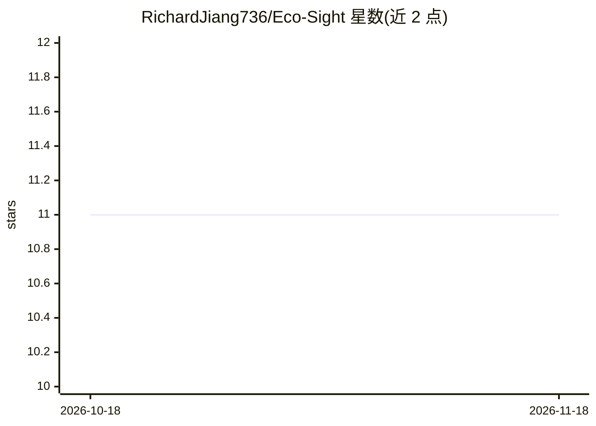

# RichardJiang736/Eco-Sight

⭐ 11 · Python · 推送 2026-07-03 · [GitHub](https://github.com/RichardJiang736/Eco-Sight) · 组织维护 · 中文 README

**自动驾驶视觉感知系统：YOLO 检测+自适应帧率调节降能耗**

基于 YOLOv10 的自动驾驶目标检测系统，内置 Python CLI，支持对视频执行推理与基准测试。核心机制为自适应模型切换：按画面检测对象数量在 yolov10n/s/m 三个自训练模型间切换并调节帧率（5-30 FPS），以降低能耗。数据采用 nuScenes 数据集（11,584 条）经标注预处理后训练，README 给出精度、延迟、模型切换开销及 Jetson 等目标设备的性能投影数据。为课程/团队项目，成员名单列于文末。

## 筛选速览

| 维度 | 判定 | 备注 |
|---|---|---|
| AI 角色 | `ai-native` | 本体是模型或模型工具 |
| 许可风险 | `none` | — |
| 部署形态 | `None` |  |
| 模型依赖 | — | README 未给出锁定关系 |
| 硬件要求 | — | 无带数字的原话,不猜 |
| 安装摩擦 | `low` | 无编译、无系统依赖或容器化 |
| 成熟度 | — | 结构信号不足 |

## 能力要点

- 按检测对象数在 yolov10n/s/m 间自适应切换并调节帧率
- 基于 nuScenes 数据集训练三个规模的 YOLOv10 模型
- 提供精度、延迟、功耗的综合基准测试命令
- 给出 Jetson Orin Nano/Xavier NX + TensorRT 的性能投影

## 适用场景

- 对驾驶视频运行自适应帧率的目标检测推理
- 评估不同 YOLOv10 规模模型的精度与延迟
- 在边缘设备上测试低能耗检测方案

## 场景标签

`目标检测` · 领域:感知与多模态

## 证据(README 行号)

> L3: **Eco-sight** 是一个自动驾驶的智能视觉感知系统，通过深度学习和自适应帧率调节技术，实现高效的实时目标检测。系统动态调整推理模型和帧率，在保证检测精度的同时降低能源消耗，为绿色智能交通做出贡献。
> L9: - **自适应模型切换**：根据检测对象数量动态调整推理模型，平衡精度与能耗
> L29: python -m eco_sight.cli run --video path/to/driving_video.mp4

## 星数曲线

2026-10-18 11 → 2026-11-18 11（+0）

---
*卡片 v1 · prompt 1.4 · 生成 2026-11-18 · 置信度 high · 依据 README sha `071970f24c48` · [字段定义](../../DATASET.md)*
