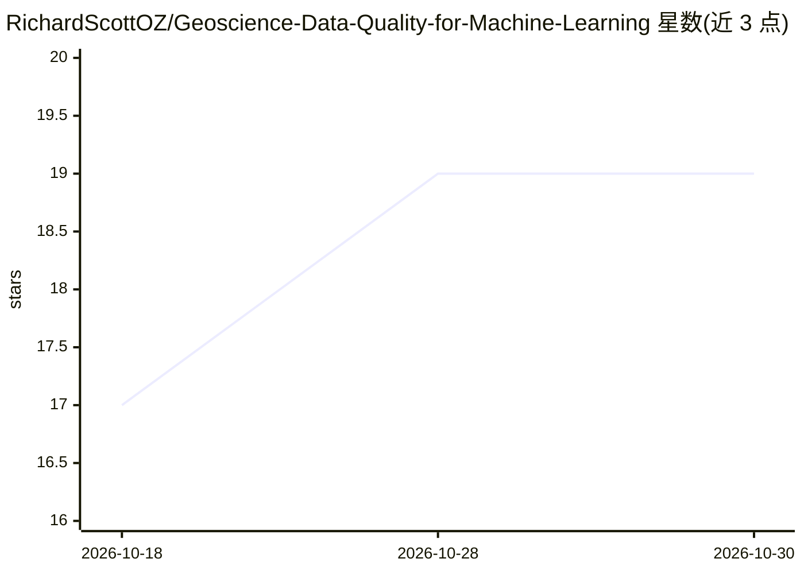

# RichardScottOZ/Geoscience-Data-Quality-for-Machine-Learning

⭐ 19 · Jupyter Notebook · 推送 2026-03-10 · [GitHub](https://github.com/RichardScottOZ/Geoscience-Data-Quality-for-Machine-Learning) · 个人维护

**地球科学数据质量评估 Python 库：为 ML 流水线量化数据质量**

面向地质、地球物理、遥感、地球化学等多源地球科学数据集的数据质量评估 Python 包：从 CSV/Excel 加载质量模型并计算分辨率与最终质量分数，分析矢量数据集中的质量字段，经 WFS 服务（如 Geoscience Australia 的 GADDS）获取并修正物探测量元数据，将质量属性栅格化，并计算观测点密度。目标是多领域数据合并进机器学习流水线前完成质量量化与制图。部分功能（Excel 支持、重力点密度）需安装可选依赖。

## 筛选速览

| 维度 | 判定 | 备注 |
|---|---|---|
| AI 角色 | `ai-ecosystem` | LLM/agent 周边工具 |
| 许可风险 | `none` | — |
| 部署形态 | `library` | 以包/库形式分发 |
| 模型依赖 | — | README 未给出锁定关系 |
| 硬件要求 | — | 无带数字的原话,不猜 |
| 安装摩擦 | `low` | 无编译、无系统依赖或容器化 |
| 成熟度 | — | 结构信号不足 |

## 能力要点

- 从 CSV/Excel 加载质量模型并计算分辨率分与综合质量分
- 分析矢量数据集的质量字段（置信度、观测方法、位置精度等）
- 经 WFS 获取并过滤/修正 Geoscience Australia 物探测量元数据
- 矢量质量属性栅格化与观测点密度计算

## 适用场景

- 我将多个领域的地学数据集合并进机器学习流水线前先做质量评估
- 我需要按分辨率、数据龄期等维度量化并制图数据质量
- 我需要从 GADDS 拉取物探测量元数据并修正几何

## 场景标签

 · 领域:地球科学/数据科学

## 证据(README 行号)

> L3: A Python package for assessing geoscience data quality for machine learning.
> L7: being combined into machine learning pipelines. This package provides tools

## 星数曲线

2026-10-18 17 → 2026-10-30 19（+2）

---
*卡片 v1 · prompt 1.4 · 生成 2026-10-28 · 置信度 high · 依据 README sha `7e39d757f4ba` · [字段定义](../../DATASET.md)*
