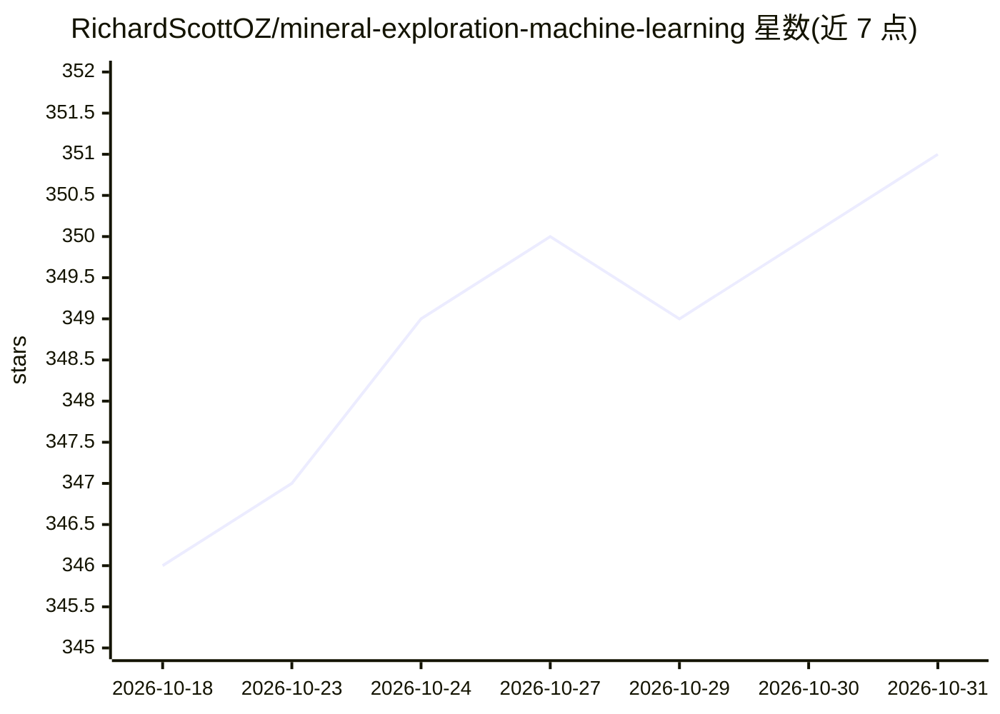

# RichardScottOZ/mineral-exploration-machine-learning

⭐ 351 · 推送 2026-10-18 · [GitHub](https://github.com/RichardScottOZ/mineral-exploration-machine-learning) · 个人维护

**矿产勘查机器学习资源清单：框架、找矿预测与地质制图代码示例**

个人维护的矿产勘查与机器学习资源聚合清单，收录作者实践中认为有用的仓库、论文、数据集与教程，多数条目附带可运行代码或示例。内容按主题组织：ML 框架（UNCOVER-ML、EIS Toolkit、TorchGeo 等）、按大洲/国家分类的找矿预测建模（Prospectivity）项目、地质与岩性制图、训练数据、矿物学、钻探、地层与构造等。条目多附论文与数据链接，部分为作者修改后留作参考的 fork。清单通过 issue/PR 接受补充建议。

## 筛选速览

| 维度 | 判定 | 备注 |
|---|---|---|
| AI 角色 | `ai-knowledge` | 知识聚合/清单类 |
| 许可风险 | `none` | — |
| 部署形态 | `None` |  |
| 模型依赖 | — | README 未给出锁定关系 |
| 硬件要求 | — | 无带数字的原话,不猜 |
| 安装摩擦 | `medium` | 含编译或系统依赖之一 |
| 成熟度 | — | 结构信号不足 |

## 能力要点

- 按主题与地域组织的资源分类（框架、找矿预测、地质、岩性、钻探等）
- 条目普遍附带论文、数据集（Zenodo 等）与代码链接
- 覆盖全球多国找矿预测建模案例（澳、加、巴西、印度、纳米比亚等）

## 适用场景

- 寻找矿产勘查领域的机器学习框架与代码示例
- 按国家/矿种查找找矿预测建模项目与配套论文
- 获取地质制图、岩性分类相关的数据集与基准

## 场景标签

`精选清单` · 领域:学习与行业

## 证据(README 行号)

> L2: This page lists resources for mineral exploration and machine learning, generally with useful code and examples.
> L3: ML and Data Science is a huge field, these are resources I have found useful and/or interesting to me in practice.

## 星数曲线

2026-10-18 346 → 2026-10-31 351（+5）

---
*卡片 v1 · prompt 1.4 · 生成 2026-10-21 · 置信度 high · 依据 README sha `f3c1e62a3fb9` · [字段定义](../../DATASET.md)*
