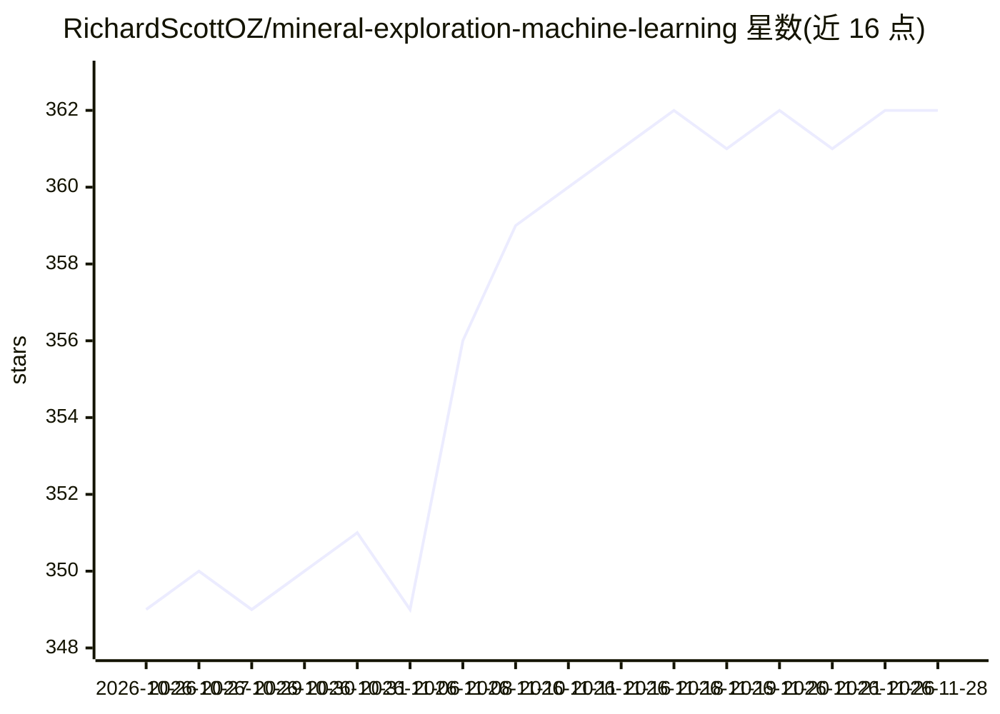

# RichardScottOZ/mineral-exploration-machine-learning

⭐ 362 · 推送 2026-11-18 · [GitHub](https://github.com/RichardScottOZ/mineral-exploration-machine-learning) · 个人维护

**矿产勘探与机器学习资源清单：汇集代码、论文与数据链接**

一个由个人维护的资源列表仓库，按类别整理矿产勘探领域与机器学习结合的代码库、论文、数据与竞赛信息。条目分为框架（如 UNCOVER-ML、TorchGeo、PySpatialML）、成矿预测（按澳大利亚、北美、南美、中国等地区组织）、地质制图、岩性识别、矿物学、钻孔数据等板块。每条目附仓库链接，常配有论文、Zenodo 数据或视频教程链接。不做安装说明，不提供本产品代码，仅作链接导航。

## 筛选速览

| 维度 | 判定 | 备注 |
|---|---|---|
| AI 角色 | `ai-knowledge` | 知识聚合/清单类 |
| 许可风险 | `none` | — |
| 部署形态 | `None` |  |
| 模型依赖 | — | README 未给出锁定关系 |
| 硬件要求 | — | 无带数字的原话,不猜 |
| 安装摩擦 | `medium` | 含编译或系统依赖之一 |
| 成熟度 | — | 结构信号不足 |

## 能力要点

- 按框架/成矿预测/地质/岩性/矿物学/钻孔等类别组织资源
- 覆盖多地区成矿预测案例与竞赛资料（Explorer Challenge、Explore SA）
- 条目常附论文、Zenodo 数据或 Collab 教程链接

## 适用场景

- 查找矿产勘探机器学习的入门代码与示例
- 调研某地区成矿预测建模的相关工作与论文
- 寻找地质制图与岩性分类的数据集

## 场景标签

`精选清单` · 领域:学习与行业

## 证据(README 行号)

> L2: This page lists resources for mineral exploration and machine learning, generally with useful code and examples.
> L16: * UNCOVER-ML Framework
> L65: # Prospectivity

## 星数曲线

2026-10-26 349 → 2026-11-28 362（+13）

---
*卡片 v1 · prompt 1.4 · 生成 2026-11-25 · 置信度 high · 依据 README sha `b452a6364aab` · [字段定义](../../DATASET.md)*
